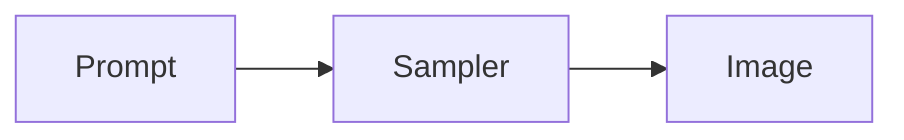

# Beyond plain GFM

> [!warning] Lower the CFG
> Above 7 the lantern prompts burn out.

A ==highlighted== phrase, a wiki link [[Run 13|previous run]], a tag #sampler/karras and a footnote.[^1]

Inline math $\sigma_i = \sigma_{max}(1 - i/N)^{\rho}$ and a display formula:

$$
x_{t-1} = x_t + (\sigma_{t-1} - \sigma_t)\,\frac{x_t - \hat{x}_0}{\sigma_t}
$$

- [/] Half-done Obsidian task
- [x] Done task

Raw HTML: press <kbd>⌘</kbd><kbd>F</kbd>, and a <span style="color:red">red span</span>.

<details><summary>Collapsed detail</summary>
Hidden until opened.
</details>

<script>document.title = "ran"</script>



```swift
struct Run: Codable { let seed: Int; var keep = false }
```

[^1]: Footnote text with a second sentence.
