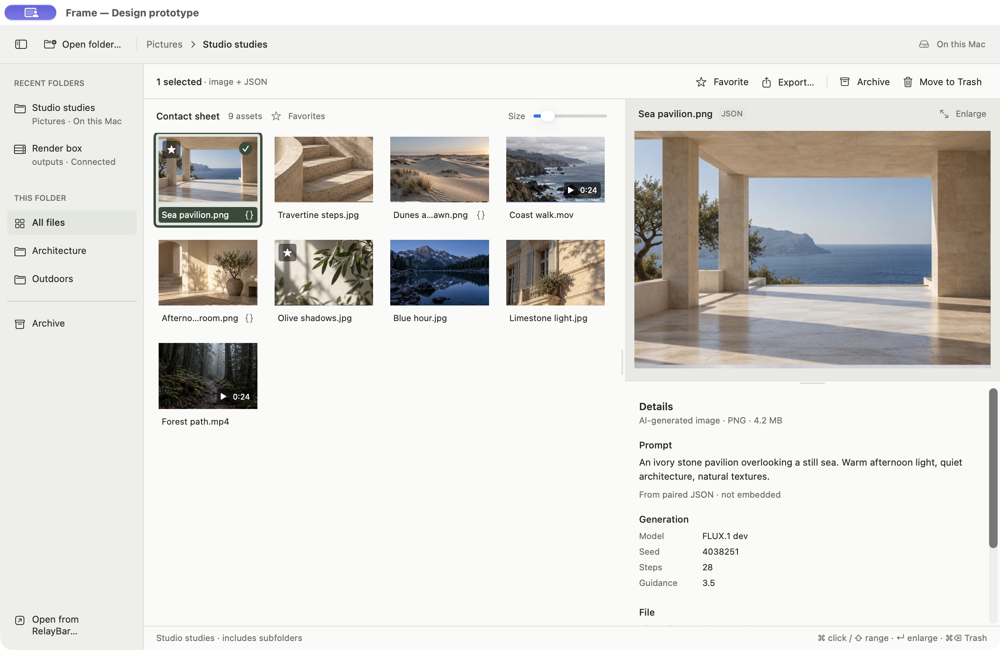
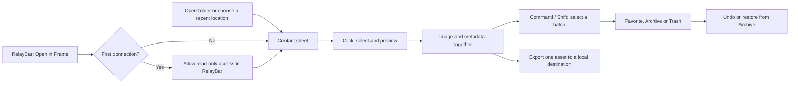
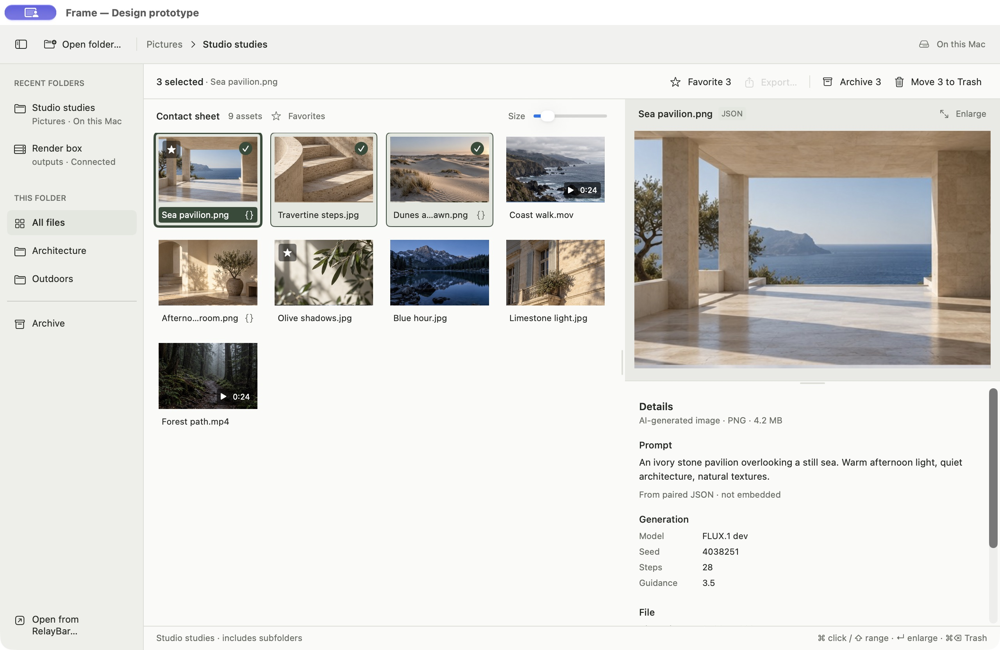
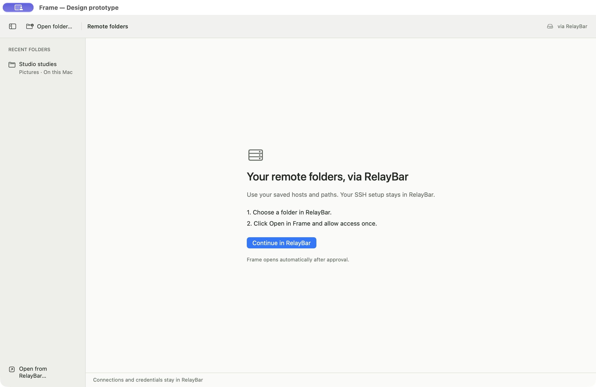

# Frame: a clearer review workspace

Status: Accepted — delivered in Frame 0.4.0 (build 5)
Date: 2026-10-22

## Recommendation

Accepted on 2026-10-22. Keep the larger preview and both resize dividers. The user authorized implementation, rebuild and replacement of Frame in Applications; no companion-app update or public release is included.

Implementation clarification: Enlarge, double-click and Return retain the dedicated viewer. Full screen is available with Control-Command-F; Escape returns to the viewer, then the contact sheet. At the user's request, full screen keeps visible heart, local Trash and Undo controls, acting on the current asset rather than a retained batch. F, Command-Delete and Command-Z remain available.

One grid-led workspace. A visible folder rail, a contact sheet, and a resizable review pane containing the image and its metadata. No Browse/Inspect mode switch is required to understand a file. Enlarge remains an optional detail view, not the normal path.

This is a screenshot of the separate native design prototype. Photos, file names, metadata and the remote host are synthetic examples. The purple title-bar indicator comes from macOS screen capture, not Frame. The accepted design is now implemented; see [production-code screenshots and verification](../system-specs/verification-2026-10-22-review-workspace.md).

## Flow

| User intent | Proposed interaction |
| --- | --- |
| Start | Open Folder opens the native folder panel. Drop a folder or click a recent location. No import or catalog setup. Restore the last available location on later launches. |
| Switch locations | Recent local folders and authorized RelayBar paths are visible in one rail, with source/path context. Current folder children are a separate section. Toolbar path survives rail collapse. |
| Review a file | Click a thumbnail once. That file becomes selected and active; image and metadata update together. No “previewed but not selected” state. |
| Review many | Command-click toggles, Shift-click ranges, Command-Shift-click adds ranges, Command-A selects visible scope. Active file always belongs to the selected set. A thicker ring identifies it; action counts refer to the full set. |
| See larger images | Size slider adjusts cells from 100–360 pt. Drag the vertical divider for preview width and the horizontal divider for image/metadata balance. Remember all sizes; preserve grid anchor during resize. |
| Cull | Favorite applies to selected assets. Mixed selection means add favorites to all; remove only when all are already favorites. Archive and Trash have explicit counts. Batch moves confirm the assets and paired files; Undo remains available beyond its notice. |
| Archive | Archive is a visible destination under the current local folder, not a filter beside Favorites. Restore replaces Archive as the action and returns assets to original paths without overwriting. |
| Export | One asset at a time. Disable Export on a batch with an explanation. Native destination selection and named replacement confirmation. Copy original bytes and paired JSON; replace destination metadata, never merge. |
| Open remotely | Returning users click an authorized recent path. First-time users see one inline setup panel: Continue in RelayBar → choose folder → Open in Frame → approve once → automatic return. No premature Retry and no duplicate host setup. |
| Recover remotely | Keep host and path visible when offline. Retry appears beside a real failure; Open RelayBar handles connection repair. Missing RelayBar is explained without a fabricated download link. |

## Layout and hierarchy

- Default 1280 × 800: approximately 184 pt rail, 609 pt grid, 480 pt review pane plus dividers. Preview defaults around 360 pt high. Four columns at 130 pt nominal thumbnail size; larger thumbnails reduce column count.
- At 960 × 640: rail collapses, path and labeled Open Folder remain visible; about 560 pt grid and 400 pt review pane. Preview height reduces to 280 pt so metadata remains usable. User resize choices are clamped safely, not silently discarded.
- The preview header contains the filename, a quiet JSON marker and Enlarge. Remove duplicate dimensions, Fit, and passive Preview labels. Details begin with useful metadata, not a large path block.
- AI prompt and compact generation fields appear first when present, with a precise source label. Embedded and JSON sources are never silently merged; conflicting values stay attributable. Raw data is collapsed. Unknown metadata remains available.
- Favorites is a contact-sheet filter. “All files · includes subfolders” states scope explicitly; folder children narrow the set. No long folder dropdown. Subfolder grouping and an additional recursive toggle are deferred rather than added without a demonstrated need.
- Recent paths show an observed remote status (Connected / Offline / Needs approval); do not poll all saved hosts just to paint a green status. Shared history remains RelayBar-owned. Long names and paths middle-truncate with full accessible labels/tooltips.
- No new editing, search, albums, tags, ratings, batch export, remote deletion, remote archive, or host management.

## Key states

[Dark appearance](assets/2026-10-22-review-workspace/grid-led-dark.png) · [Compact window](assets/2026-10-22-review-workspace/grid-led-960.png)

## Design review and iterations

Only the brief and explicitly scoped synthetic screenshots were shared for this revision. No real images, host history, credentials, or RelayBar source were sent.

1. [Current UI audit](assets/2026-10-22-review-workspace/design-review-round-1.md): rejected four-column density and preview/selection mismatch. Adopted a selected active item, Archive destination, persistent path, and inline remote setup.
2. [Two layout alternatives](assets/2026-10-22-review-workspace/design-review-round-2.md): recommended grid-led. Enlarged the preview, removed redundant preview chrome, added current-folder children and recents, strengthened active selection and count-labeled actions. Image-led remains a comparison in the interactive mock, not a second proposed shipping mode.
3. [Final design gate](assets/2026-10-22-review-workspace/design-review-round-3.md): ready for user feedback, with three specific refinements. Added a filled filename strip for the active tile, separated Archive from ordinary subfolders, and removed the empty folder heading in remote setup. Favorite also shows the selected batch count. These follow-ups were checked after the review; no fourth design review is claimed.

The review's pixel estimates were approximate; source measurements and actual screenshots take precedence. Its mistaken attribution of macOS capture chrome to the app was corrected. A recursive toggle and grouped grid were not adopted: current-subtree navigation addresses the immediate need without another browsing mode. Those ideas remain possible follow-ups after real large-folder testing.

## Prototype and verification boundaries

- Native screenshot prototype: [WorkspaceDesign.swift](../../Scripts/WorkspaceDesign.swift), separately built under `.build/FrameDesign.app`. It uses generated samples only. The design-only stage changed no installed app or real library; the later authorized implementation is recorded separately below.
- Interactive comparison: [editable source](assets/2026-10-22-review-workspace/frame-workspace.template.html), [self-contained fragment](assets/2026-10-22-review-workspace/frame-workspace.html), and [build script](../../Scripts/build-workspace-mock.mjs). The fragment is under 1 MB and has no network calls. JavaScript syntax was checked.
- Native screenshots were captured at 1280 × 800 and 960 × 640 content sizes, with light/dark, single/batch, and remote-setup states. The browser tool denied local-file navigation; no browser-render or full browser-interaction verification is claimed. The native and inline mocks express the same direction but are not pixel-identical.
- All file actions, remote consent, playback and export in the prototypes are simulated. Native keyboard hints describe the intended production contract; the disposable mock does not implement the entire keyboard/undo/accessibility matrix. It is not a performance benchmark.
- Implementation must retain reusable AppKit cells, bounded decoding/cache, selected-preview priority, cancellation, stable IDs, source permissions, pairing transactions, and all existing non-destructive file-operation invariants. A pretty nine-item demo is not evidence of smoothness with 5,000 assets.

## Generated sample-media provenance

Built-in image generation produced [sample-contact-sheet.png](assets/2026-10-22-review-workspace/sample-contact-sheet.png); [JPEG encoding](assets/2026-10-22-review-workspace/sample-contact-sheet.jpg) is embedded in the mock. These are illustrative pixels, not photographs from the user's library. Mock generation metadata is fictional and does not describe the image-generation tool's actual settings.

Prompt: “Use case: photorealistic-natural. Asset type: one photographic contact-sheet sample image for a local photo viewer UI prototype. Generate a clean 3 by 3 contact sheet, exactly nine equal rectangles in a precise grid, no spacing, borders, labels, text or UI. Canvas 3:2 landscape; each cell landscape 3:2. Nine distinct natural editorial photographs in reading order: 1 a wide sunlit ivory concrete pavilion framing a calm blue sea, 2 a close-up of curved travertine stairs with long shadows, 3 windswept pale sand dunes at dawn, 4 an overcast rugged Pacific coastline, 5 warm sun across a minimal plaster interior with an olive tree, 6 delicate green leaves and soft window shadows, 7 a mountain lake in blue twilight, 8 a sunlit limestone facade, 9 a dark quiet forest path in mist. Photorealistic materials, nuanced light, restrained natural colors, architectural photography, no people. Keep all nine photos separate in their exact rectangular cells. Output is sample media, not an app design.”

## Accepted decision and delivery

The user accepted the grid-led balance, explicitly kept the larger resizable preview, and authorized rebuilding/updating Frame in Applications. The [implementation task](../task-specs/2026-10-22-review-workspace.md) records delivery in 0.4.0, including the follow-up request for full-screen heart and Trash controls. [Verification](../system-specs/verification-2026-10-22-review-workspace.md) distinguishes tested behavior from extended acceptance still pending.
