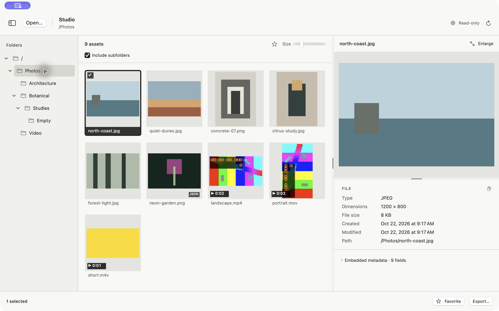
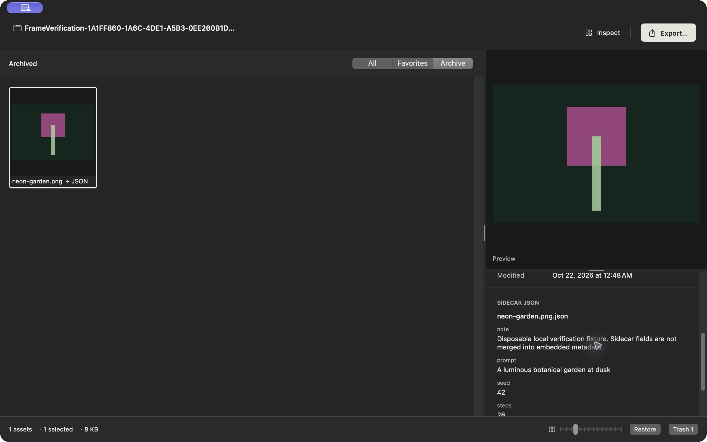

# System specification

Snapshot: 2026-11-07 · Bridge v6 bundles installed in Applications as Frame 0.1.0/15 and RelayBar 1.6.0/20. Release versions unchanged; local signed update only. Both apps are running; native local and real-host Markdown/HTML checks passed.

## Purpose and current state

Frame is a native macOS 14+ folder viewer for Markdown, HTML, JPEG/PNG and MP4/MOV/M4V. Local viewing remains independent and offline. Remote viewing uses RelayBar's SSH/SFTP connections. Finder or the selected host remains the source of truth; favorites and local folder bookmarks live in Frame's private SwiftData catalog. See [document workspace](document-workspace.md) for the new Preview layout, native file tree and document resource contract.

## Supported workflows

| Workflow | Delivered behavior |
| --- | --- |
| Open and switch | One Open… button / Command-O presents a sheet: local folder picker and five recent local paths above remote host/path recents and Browse in RelayBar. Folder drop is retained. The rail now concentrates on an expandable hierarchy, including empty local folders, with Archive separate. It remains visible by default at minimum width and can be toggled. Paths stay in the toolbar. Relaunch restores the last local root; unavailable roots offer Locate Folder without losing catalog identity. |
| Browse | Preview or Grid, sharing one selection. Opening a root restores its saved layout (Preview for a new root). Clicking a folder opens its contents in Grid without overwriting that preference; explicit Preview/Grid changes persist. Grid retains adjustable thumbnails (100–360 pt), attached preview and metadata. All files is the default. File type (Images, Videos, Documents, Other files) combines with Favorites / Hide favorites in the current folder/Subfolders scope. A filtered count shows N of M files, and an empty filter offers Show all files. Archive stays separate. Stable-ID diffs retain surviving previews and viewport position after Delete. |
| Settings | Frame → Settings… → Show remote folders persists. Turning it off hides remote choices, prevents catalog and handoff requests, cancels the active remote view and returns to the local empty workspace. It does not stop RelayBar, revoke its consent or erase shared history. |
| Select | Normal click/Cmd-click/Shift-click and Cmd-A retain native selection. Select mode separates checked deletion targets from preview: click/arrows browse, checkbox/Space toggles the current target. Done returns to normal selection. Active preview has a thick ring; checked targets have checks. |
| Viewer / full screen | Expand icon/Return/double-click opens the viewer; remote images retain the 2048-pixel derivative until Original is chosen. Left/Right traverse the visible folder/filter after clicking metadata or controls. Full screen retains heart and counted Delete in Select mode. No separate Focus command. |
| Video | Selected remote video downloads for native AVKit playback in the attached pane or viewer; grid posters never trigger whole-video downloads. Host ffmpeg/ffprobe is optional for posters, not required for playback. Playback is released on selection/root/scope/filter changes. Codec support depends on macOS. |
| Delete | Button, Delete/forward Delete or Cmd-Delete removes remote media and every companion permanently, without confirmation or Undo. A selection uses bounded batch requests/helper invocations with per-item outcomes. Local files use macOS Trash and session Undo. A surviving preview stays put; a removed preview advances in previous visible order. Text editing and open sheets suppress shortcuts. |
| Favorite | F/heart toggle the current favorite and advance, wrapping within the visible scope. Select mode preserves checked deletion targets. Normal multi-selection retains batch Favorite; mixed selection adds to all, removing only when all are favorites. |
| Export | Single-file byte-exact copy, including videos. An existing destination is atomically replaced using the new file’s metadata, not merged with its old metadata. Source-path, symlink, and hardlink aliases are rejected. Favorites are not embedded. |
| Refresh | Local filesystem events reconcile changed loaded branches and document resources. Foreground remote documents revalidate loaded resources with a bounded batch every three seconds. Command-R reconciles the visible document directory; media keeps its existing refresh behavior. Root and selected-file availability are rechecked when the app becomes active. |

## Assets and remote folders

- **Companion groups:** one media tile can own multiple same-folder files of any companion extension: `name1.png`, `name1.prompt.json`, `name1.xyz.json`, `name1.qqq.txt`. Longest dot-delimited prefix wins, full media filenames win equal-stem ties, and ambiguous stems remain ungrouped. Supported media files never become companions of one another. The first JSON (exact name, bare stem, then other JSON) supplies the generation summary; each companion has its own collapsed filename/text preview. No merging or source rewriting.
- **Archive:** local and remote groups move together into managed Archive records. Normal filters exclude them; Restore refuses occupied paths. See [remote contract](remote-assets.md).
- **Grouped actions:** remote Delete unlinks the entire group. Local Trash/Undo and Archive/Restore retain preflight and rollback. Export includes all companions, replaces matching destination files byte-for-byte and refuses ambiguous/stale extra companions rather than silently merging them. Single-file export retains its Save panel.
- **Remote locations:** Open… reads RelayBar's authorized catalog only when its remote section is available. Existing host/path rows reopen directly. Browse in RelayBar launches the installed trusted companion; its Open in Frame action returns to Frame. First-use consent remains in RelayBar and is revocable there. New host/path choices stay in RelayBar rather than a duplicate picker. Frame stores no SSH keys, arguments, passwords, or separate host history. Favorites use an opaque connection-derived root ID plus the absolute media path.
- **Folder/file tree:** native virtual rows retain real nesting for both sources. Expansion loads one directory and never downloads media. Parent navigation extends the remote hierarchy upward. Failed rows retain an error tooltip; selecting/reopening the folder retries. Sidebar counts are omitted; Grid counts files. General files and owned companions are visible; companion tiles are labeled and remain managed through their owner. Reading failures offer Retry instead of implying an empty folder.
- **Recursive scope:** Include subfolders is opt-in remotely, breadth-first and progressive. Stop / Escape cancels and retains loaded results. Partial exposes details and Scan Again. Bounds: 512 folders, 20,000 files, depth 64; stop after three folder errors. The in-memory tree is bounded to 20,000 nodes and its 60-second directory cache to 64 listings / 20,000 files. Navigating or hiding remote cancels old work and rejects late results.
- **Remote media:** host-generated 512-pixel thumbnails and 2048-pixel previews include metadata; temporary local cache avoids retransfers in one session. Images download only for Original/Export; selected video downloads for native playback. Remote Delete/Archive/Restore do not download originals.
- **Transfer limits:** one directory request and two prioritized media operations; bounded session-only derivative and original caches. [Exact bounds](remote-assets.md#cache-and-limits).
- **Shared recents:** Frame never changes RelayBar history, including explicit subfolder opens. Bridge v6 requires both updated apps; legacy rememberOpen is a no-op. The source now uses bridge v7 (one connection per session; see RelayBar's Frame viewer spec); it is not installed, and v6 and v7 reject each other.
- **Performance caveats:** first-visit derivatives read/decode originals on the host, with bounded concurrency. Repeat visits validate local cached derivatives using remote stat fingerprints. Scanning does not prefetch originals. No private-host latency claim is made.

The initial remote handshake, installed offline recovery, and consent gate were verified. A full one-click handoff to a user-selected host remains a manual acceptance item; no private host was opened for testing. See [verification](verification-2026-10-22.md).

Opening/changing a root/scope/filter previews the first visible item. In Select mode it can be outside the checked set; no checked targets means Delete is disabled, not a hidden fallback to the preview. File operations lock navigation/selection until their outcome is known. Stable item IDs, not stale indexes, identify targets.

## Appearance and metadata

The interface follows macOS Light/Dark appearance. Minimum content size: 960 × 640. The attached preview and metadata remain resizable. Open uses Local/Remote sections without repeated onboarding. The toolbar has one location line; redundant JSON badges/source captions, Size text, duplicate Undo controls and Read-only badges are removed. Hearts are consistent throughout.

Metadata is lazy and read-only: source-labeled JSON/embedded generation sections when present, File, Capture/Video, then collapsed raw sources. JSON and embedded fields never silently merge. ImageIO and PNG tEXt/zTXt/iTXt parsing expose common generation fields and Automatic1111 parameter blocks; unrecognized embedded data remains readable. Video identity includes duration, oriented dimensions, frame rate, codec, and audio when available. Unsupported video decoding retains usable file metadata and offers Reveal in Finder.

## Runtime and invariants

- `Frame`: SwiftUI shell and inspector, native commands, reusable AppKit collection, AVPlayerView, and folder chooser.
- `FrameKit`: scanner/query, selection rules, metadata readers, ImageIO/AVFoundation downsampling, SwiftData catalog, file operations, and playback lifecycle.
- Thumbnail cache has a 128 MB cost limit and four decoder slots. Offscreen work is cancelled and checked before decoding; pane previews are downsampled and debounced. Size-aware Retina requests use 128 px buckets, at most 1,152 px for cells and 4,096 px for the attached preview. Existing cell images stay visible during an upgrade. Video metadata has bounded concurrency/cache. No hover playback.
- Root UUIDs and root-relative favorite keys retain the existing schema. Removing a recent shortcut does not remove catalog records or originals.
- Browsing, metadata reads, favorites and filtering never rewrite source metadata. Explicit Delete, local Trash, Archive/Restore and Export can change files. Once linked to RelayBar, remote Delete has no further prompt.
- Frame retains App Sandbox, bookmarks, and user-selected read/write access. It adds network-client and `39HYFR5Z65.FrameRelay` App Group entitlements for local UNIX-socket IPC. RelayBar remains unsandboxed and owns SSH. Both endpoints verify kernel audit-token code identity against the expected bundle and Developer ID team before requests. The URL scheme carries only a single-use 60-second nonce, not host credentials or commands. Design consultation is not a product feature.

## Limits

No editing, RAW/HEIC/TIFF/GIF, transcoding, codec downloads, batch export, tags, ratings, search, or cloud library. A Finder rename is remove/add and can lose the favorite association. Local Undo is session-only; remote Delete has no recovery path. Filesystem identity checks are best-effort checks immediately before operations, not an atomic filesystem transaction against concurrent external writers.

This is a local Developer-ID-signed delivery, not a notarized/published distribution. Frame is arm64; RelayBar is universal. Intel runtime, macOS 14 runtime, arbitrary network-filesystem behavior and the complete accessibility/error-state matrix were not manually tested. No Finder mount or automatic credential/package installation is included. The missing-Frame download link remains disabled.

## Verification and history

[Current verification](verification-2026-11-07-documents.md) records document tests, resource boundaries, file watching, performance and signed bundle installation, with native screenshots and explicit stress/fault coverage limits. [Previous media verification](verification-2026-10-22-smooth-review.md) records native grouped-file/selection/favorite-and-next checks and the 2,000-item deletion exercise.

[0.6.0 remote-asset verification](verification-2026-10-22-remote-assets.md) records preview/cache, safe remote actions, history isolation, signed Applications updates and explicit real-host acceptance limits.

[0.5.1 explicit-history verification](verification-2026-10-22-explicit-history.md) records 73 passing Frame tests, 312 passing RelayBar tests (22 opt-in skips), protocol guards, passive-read and cached-open regressions, both signed Applications updates and installed shared-catalog connectivity. No private-host folder was opened for testing.

[0.5.0 folder-tree verification](verification-2026-10-22-remote-folder-tree.md) records 69 passing tests, two design review rounds, native lazy-tree/recursive/Stop/chooser/settings/light-dark/resizing checks, installed hashes and the 0.4.0 rollback app. Synthetic 512-folder / 10,240-asset traversal took 0.2357 s excluding network latency. Live host/authentication and throughput acceptance remain unverified.

[0.4.0 workspace verification](verification-2026-10-22-review-workspace.md) records 57 passing tests, native layout/resizing/culling/full-screen checks, installed hashes, rollback copies, and remaining remote, stress and accessibility acceptance limits. The three design reviews informed the accepted layout; no additional external review was needed for implementation.

[0.2.1 resize verification](verification-2026-10-21-resizing.md) records 34 passing tests, native resizing, screenshots, installed hashes, and the preserved previous app. [0.2.0 verification](verification-2026-10-21.md) remains the historical evidence for appearance, videos, folder selection, and batch actions.

[Task archive](../task-specs/README.md) contains the original delivered design, the three approved redesign tasks, and the Contact Sheet amendment. Build with `make app`; output is `.build/app/Frame.app`.

[HTML parity verification](verification-2026-11-07-html-parity.md): RelayBar now previews HTML directly; both renderers allow online resources with macOS transport protections retained.
