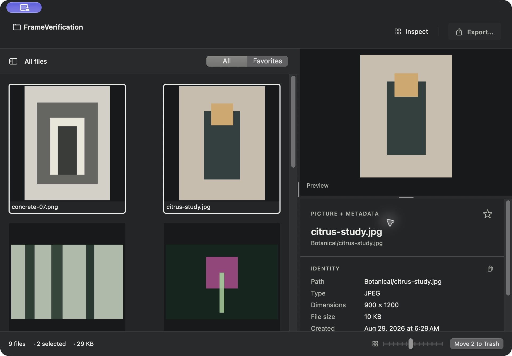
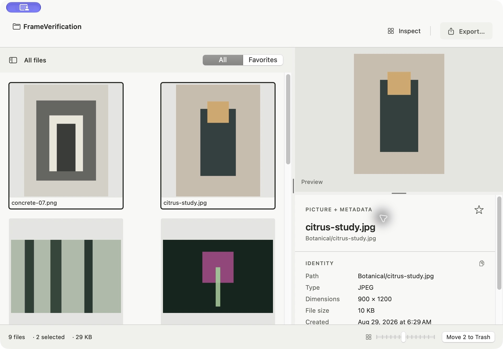

# Frame 0.2.1 verification

Date: 2026-10-21
Installed: `/Applications/Frame.app` · version 0.2.1 · build 3

## Automated checks

`swift test`: 34 tests passed, zero failures. The four new tests cover sizing limits and column/row geometry, saved thumbnail preference without changing selection, bounded Retina requests, and a real 2,048 px PNG decoded at both 256 px and 1,280 px. Existing scanner, metadata, video, export, batch Trash, and Undo tests still pass.

Fixture timings from the final run: 5,000-file scan 0.219 s; filter 0.0033 s. These are local synthetic fixtures, not remote-transfer or general real-world performance claims.

`Scripts/build-app.sh release`: successful. Strict/deep signature verification passed before and after installation. Bundle version/build, arm64 executable, macOS 14 minimum, icon checksum, and retained App Sandbox/user-selected-file/bookmark entitlements verified. No networking entitlement was added.

## Native interaction checks

- Thumbnail slider dragged from 160 to 340 pt with a two-item selection intact; accessibility Increment/Decrement also works.
- Higher-resolution requests are backed by the automated actual-decode test, not merely larger cell frames.
- Both divider handles dragged repeatedly, before and after selection and folder-outline changes. Final native positions changed from 555/264 to 492/321 and then 557/276 pt.
- A native holding-priority constraint initially blocked dragging. Corrected priority, visible 6 pt handles, and normal responder-loop tracking resolved the SwiftUI-hosted drag interaction; AppKit still enforces bounds and autosaves sizes.
- Inspect round trip preserved the two-item selection and both pane positions. Relaunch, including the installed release, restored pane positions and thumbnail size.
- Down moved from the first tile to the third in a two-column layout.
- Light/Dark appearance and the 960 × 640 minimum window were inspected with synthetic JPEG/PNG/video fixtures. The normal 1280 × 800 test window exceeded the available display crop, so complete screenshots use the minimum window.
- Installed release launches normally, has no debug Verification menu, restores the prior library/favorites, and has zero batch targets selected. Thumbnail preference was returned to the original 160 pt; verification did not alter user media.

## Artifact and recovery

- Installed executable SHA-256: `f30ec8583783f40ec2e34367bb789fd5dc4666b633f5e40a61ea659169ffb8e9` (matches built executable).
- Previous app preserved at `.build/backups/Frame-0.2.0-build2-2026-10-21.app`; executable SHA-256 `8e6dc589edcafe6447befa9bac284241617a6e3b7e43636d4ee5ec339792f468`.
- App icon SHA-256: `7dea6a405517146a4432e91c7e9ff4db755074d9e13cdf5eb299f15f33c9e04b` (source and built resource match).
- Preferences, bookmarks, and SwiftData catalog were not replaced. This is a local ad-hoc-signed arm64 installation, not a public/notarized release. The workspace has no Git repository, so no source commit/tag is claimed.

## Limits

Full VoiceOver/keyboard divider traversal, Intel hardware, macOS 14 runtime, and every scroll-anchor edge case were not manually exercised. Remote, archive, and JSON asset workflows are proposals only; no private SSH configurations, keys, or servers were accessed and the reference app was unchanged.
