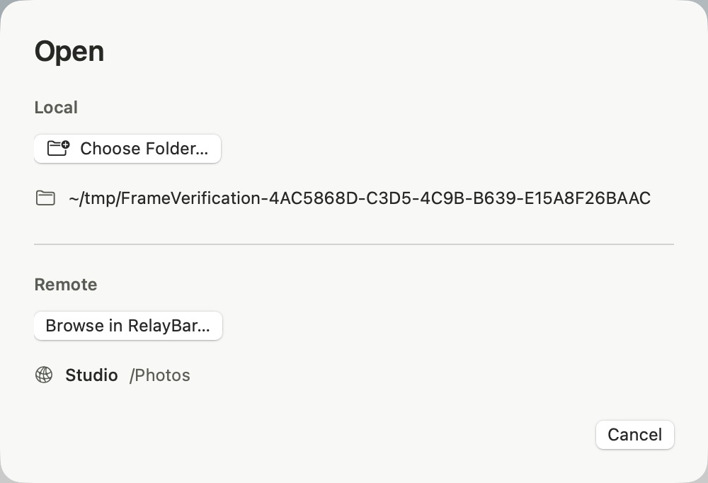
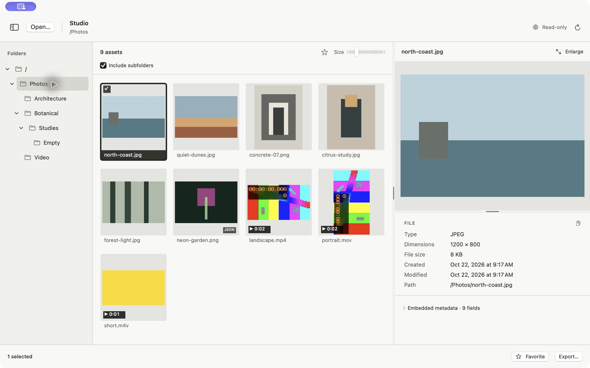
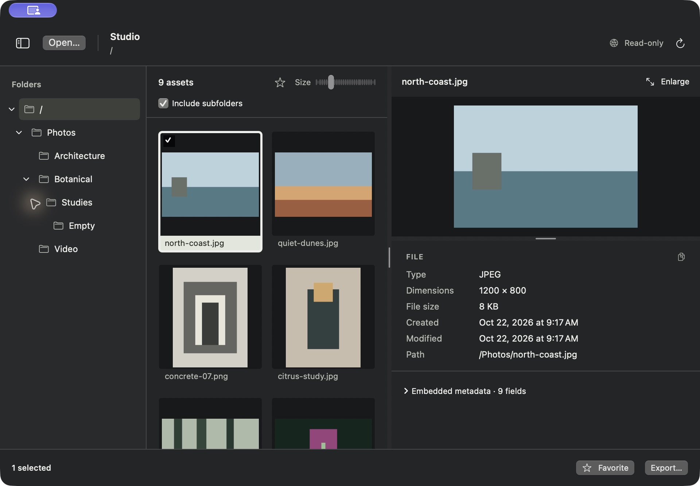
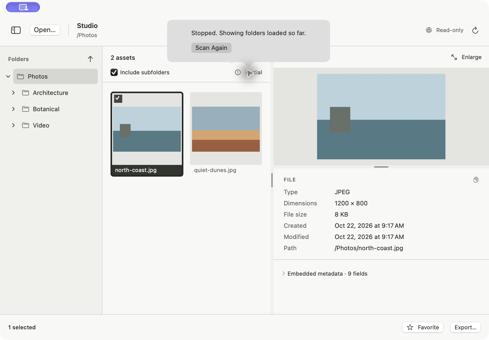

# Frame 0.5.0 folder-tree verification

Date: 2026-10-22
Installed: `/Applications/Frame.app` · 0.5.0 (build 6) · arm64

## Automated checks

`swift test -Xswiftc -warnings-as-errors`: **69 passed, zero failures**. Logs: `.build/remote-tree-tests.log`, `.build/remote-tree-debug.log`, `.build/remote-tree-release.log`.

New coverage includes on-demand expansion without traversal, cache reuse, concurrent-request deduplication, one-consumer cancellation, nested and parent hierarchy retention, recursive snapshots, folder/asset bounds, denied-directory partial results, cancellation rejecting late publications, navigation/hide isolation, persistent remote visibility, no catalog/handoff while hidden, empty local directories, direct versus recursive local scopes, and expired RelayBar listing renewal refusing changed same-sized files. Compact sizing tests verify two approximately 143 pt thumbnails at a 160 pt preference in a 330 pt grid; large preferences retain a single column.

Last measurements on this Mac:

| Check | Measured |
| --- | --- |
| Real-file local scanner, 5,000 files | 0.3102 s |
| Local filter, 5,000 files | 0.0060 s |
| Synthetic remote traversal, 512 folders / 10,240 assets | 0.2357 s |
| Stage plus 12 decodes | 0.0017 s |

The remote figure measures application bookkeeping with an in-memory transport, not SSH/SFTP speed or a native 10,000-thumbnail scrolling benchmark.

## Native checks

Used a separate sandboxed debug bundle with production views, isolated preferences/catalog, and synthetic local image/video/JSON fixtures. Its injected remote loader has a 350 ms directory delay and serves only bundled fixtures; it does not connect to a host. The synthetic media files remain local decoder inputs, so the screenshots do not prove real remote transfers or video download behavior.

- Expanded Botanical → Studies → Empty without changing the active preview; selected a child while preserving ancestors/siblings. Parent shortcut extended the tree upward. Root-parent action disappears at `/`.
- Include subfolders changed two direct images to nine total assets. Escape interrupted a fresh recursive scan, kept its two loaded assets and showed Partial. Scan Again returned all nine and cleared Partial.
- Native local folder picker opens from Open → Choose Folder; cancelling retains the active library.
- One compact Open sheet, local above remote, actions before recent rows, no inline onboarding page. Settings toggle removes remote choices and closes the active remote session. Settings persistence has automated coverage.
- Dragged width divider from 330 to 566 pt and image-height divider from 482 to 366 pt; slider changed 100 → 160. Stored preferences survived the verification-app restart.
- Checked light at 1280 pt and dark at 960 pt; the rail remains visible and the final compact grid fits two columns at the 160 pt preference.
- Installed release launched and restored the existing 1,666-asset local library, existing favorite, and 100 pt thumbnail preference. Its Settings window exposes Show remote folders, enabled by default. No private-media screenshots were saved or sent to the reviewer. No user source media was moved.

## Final screenshots

All images capture production views with synthetic fixtures. Open and the tree screenshots were refreshed after the second design review refinements; unchanged Settings/local-only captures are retained. The purple capture indicator is macOS UI.

[Settings](assets/2026-10-22-remote-folder-tree/settings.jpg) · [Local-only chooser](assets/2026-10-22-remote-folder-tree/local-only.jpg)

## Installation and rollback

`Scripts/build-app.sh release` completed in 19.09 s. Developer ID Application: Thought Tides LLC (39HYFR5Z65), timestamp Oct 22 2026 14:31:40, hardened runtime. Strict signature verification passed before staging and after installation. Existing sandbox, bookmarks, user-selected read/write, network-client and FrameRelay App Group entitlements are unchanged.

The prior installed bundle was moved intact to `.build/backups/Frame-0.4.0-build5-2026-10-22.app`; preferences and catalogs were not replaced. This is the recoverable rollback app. Earlier backups were preserved.

| Executable | SHA-256 |
| --- | --- |
| Built and installed Frame 0.5.0 | `31a523d3e1f4a838c63c8a798e8f47548fe14118574b911b712930d341fe6c02` |
| Prior Frame 0.4.0 backup | `f117e59124524169cae5527fa054c5c641e72a2a77c2ff633b5eed67d10c0eca` |
| RelayBar, unchanged | `7f3cc44937cc8a9c126e73b319bd608c1baeb2b3eb57b28d75a5e29db1b19919` |

No Git repository, commit, tag, notarization submission, public upload or RelayBar update was performed. This is a locally installed signed build, not a notarized distribution.

## Performance and remaining limits

Recursive scanning is opt-in and stops at 512 visited folders, 20,000 assets, depth 64, or three folder errors. Partial is explicit. One listing request runs alongside up to two media transfers. Listing/index caches are bounded; expired capabilities renew on demand rather than failing after RelayBar's 32-listing retention window. Folder expansion never fetches image contents.

Real SSH/SFTP latency and large originals remain the dominant costs: RelayBar transfers original images before Frame can downsample thumbnails, with the existing 100 MiB per-media ceiling and 512 MiB transfer cache. Scanning can take minutes on high-latency hosts even though the UI remains cancellable. RelayBar v1 records every successful directory list in shared history; expansion and recursive scans therefore affect shared recents. Avoiding that needs a coordinated companion protocol change, outside this Frame-only update.

No private host was opened for acceptance testing. Live authentication/offline/revocation matrices, real-network throughput, long-session memory profiling, a full VoiceOver pass, Intel/macOS 14 runtime, and the earlier archive failure matrix remain unverified. Native preview splitters still expose disabled AX adjustment even though pointer dragging works. Tree row buttons and disclosure controls are accessible; this is not a claim of full keyboard tree-navigation or VoiceOver coverage.

See the [task and design record](../task-specs/2026-10-22-remote-folder-tree.md) for scope and review decisions.
