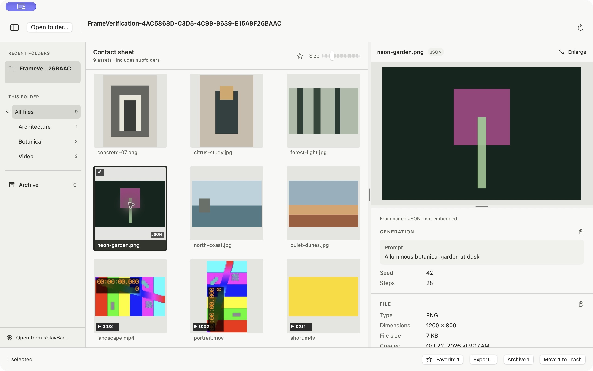

# Frame 0.4.0 review-workspace verification

Date: 2026-10-22\
Installed: `/Applications/Frame.app` · 0.4.0 · build 5 · arm64

## Delivered

The [accepted grid-led design](../design/2026-10-22-review-workspace.md) is implemented in production SwiftUI/AppKit code. A visible folder rail replaces the dropdown, the larger attached preview retains both resize handles, and the action bar names its selection counts. The active preview always belongs to the selection. Archive is separated from ordinary folders, Favorites applies to batches, and paired JSON generation fields have explicit provenance without merging embedded data.

Enlarge, Return and double-click retain the dedicated viewer. Control-Command-F opens full screen. Its bottom bar includes heart, local Trash, Undo, and previous/next actions; culling there targets the current asset, not the retained batch. Escape exits full screen, then returns to the contact sheet.

Remote setup is inline, with RelayBar-owned hosts/history and one primary Continue action. It hides unrelated local actions and empty child-folder headings. Catalog failures expose recovery details; remote listings retain their chosen host/path on failure. No download URL was invented.

## Automated verification

`swift test -Xswiftc -warnings-as-errors`: **57 tests passed**, zero failures. Build log: `.build/workspace-tests.log`.

Added coverage: active-selection membership, empty-preview clearing, hidden-ID rejection, selected first asset after scope changes, mixed batch favorites, paired-member counts, remote setup mutation gates, catalog revocation/retry, and source-specific JSON summaries. Existing pairing, Archive/restore collision protection, exact-copy export, Trash rollback/Undo, video, remote cancellation/cache, stale scans and resize bounds remain covered.

Final 5,000-file scanner benchmark: **0.294 s**; filter: **0.0066 s**. These measure scanner/query work, not native scrolling or network performance. The unchanged cell cache remains 128 MB with four decoder slots and bounded 1,152 px tile / 4,096 px preview requests.

## Native verification

Used a separate sandboxed debug build of the production sources, `com.lx2026.Frame.workspace-verification`, with nine synthetic image/video fixtures and paired JSON. No private source media was moved or captured.

- 1280×800 initial layout: approximately 184 pt rail, 609 pt grid, 480 pt preview; preview height 352 pt.
- Light/dark appearance, 960×640 auto-collapsed rail, long root/path text, portrait and landscape images, video posters, metadata scrolling and JSON source labels.
- Dragged preview width from grid position 609 to 539 pt and image height from 352 to 412 pt. Compact layout clamps safely. User-set splits and 130 pt thumbnails survived a normal quit/relaunch.
- Native Size accessibility decrement changes by 10 pt; selection remains stable.
- Shift-arrow range, Command-A, Command-Shift-A, Return, Escape and Control-Command-F exercised. Clearing selection clears image/metadata and disables actions.
- Two selected assets, one paired JSON: Trash and Archive confirmations correctly report **2 assets / 3 files**. Trash/Undo and Archive/Restore restored the disposable fixtures.
- Full screen with a nine-asset batch retained: heart affected only the current image; Trash removed **1 asset**, advanced to the next and exposed Undo. Command-Z restored the asset; returning to the sheet showed only the intended favorite.
- Inline remote setup displayed without local action controls or a blocking sheet. This unsigned fixture cannot access the signed RelayBar bridge; no consent was granted or private host opened.
- Installed release relaunched successfully into the existing local root (1,666 assets), preserving its favorite and 200 pt thumbnail preference. No screenshot of that private library was saved.

[Compact dark window](assets/2026-10-22-review-workspace/compact-dark.jpg) · [Full-screen heart and Trash](assets/2026-10-22-review-workspace/fullscreen.jpg) · [Inline remote setup](assets/2026-10-22-review-workspace/remote-setup.jpg)

Screenshots come from the production-code verification app, not the earlier design mock. The purple capture indicator is macOS UI.

## Build and installation

`Scripts/build-app.sh release` completed; strict signature verification passed before and after installation. Developer ID: **Thought Tides LLC (39HYFR5Z65)**, timestamped hardened runtime. Sandbox, user-selected read/write, bookmarks, network-client and the existing FrameRelay App Group entitlements are unchanged.

Executable SHA-256:

- Frame 0.4.0: `f117e59124524169cae5527fa054c5c641e72a2a77c2ff633b5eed67d10c0eca`
- Preserved Frame 0.3.0: `54876baea107ffb09c9b74d38561257d1725caca2d83881cf9dbd62eca3cce26`
- RelayBar unchanged: `7f3cc44937cc8a9c126e73b319bd608c1baeb2b3eb57b28d75a5e29db1b19919`
- Frame icon unchanged: `7dea6a405517146a4432e91c7e9ff4db755074d9e13cdf5eb299f15f33c9e04b`

Rollback bundles:

- `.build/backups/Frame-0.3.0-build4-2026-10-22.app` — verified copy.
- `.build/backups/Frame-0.3.0-build4-original-2026-10-22.app` — original installed bundle moved aside.

The app was quit normally, a verified update staged in Applications, and the original retained before replacement. Preferences/catalog were not deleted. RelayBar was neither restarted nor modified. This is a local signed installation, **not a notarized or published release**.

## Remaining acceptance limits

No full VoiceOver session, Intel/macOS 14 runtime, 5,000-tile native memory/scroll benchmark, high-latency remote UI workload, real-user host consent/handoff, or full offline/denied/revoked/outdated companion matrix was performed. Existing remote and archive failure-matrix limits from [0.3.0 verification](verification-2026-10-22.md) remain. Accessibility names expose active vs selected and the slider supports increment/decrement; native splitters still report disabled in the AX tree despite working with pointer dragging, so keyboard/VoiceOver divider adjustment needs follow-up.
