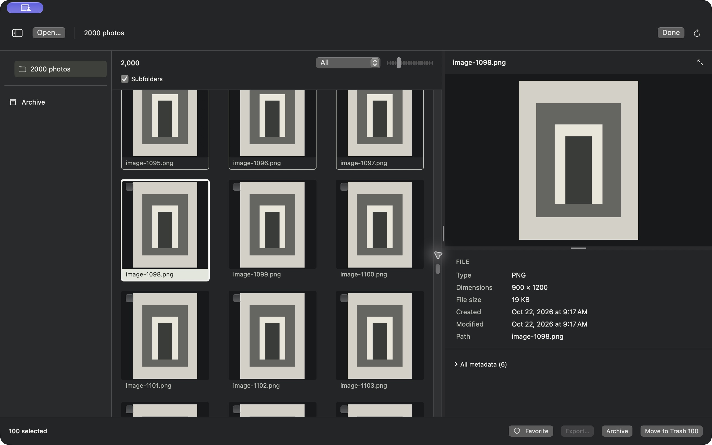
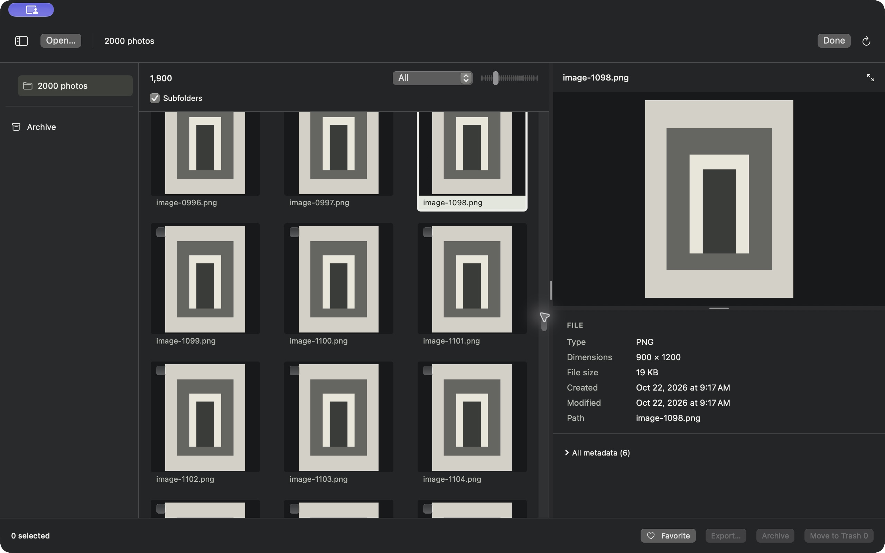

# Smooth review verification

2026-10-22 source verification; Applications updated on 2026-10-23.

## Installed update — 2026-10-23

- Frame **0.1.0, build 11** at `/Applications/Frame.app` (arm64); RelayBar **1.6.0, build 17** at `/Applications/RelayBar.app` (arm64/x86_64). Bridge v5. Release versions unchanged.
- Both Release builds completed with timestamped hardened-runtime Developer ID signatures, team `39HYFR5Z65`. Installed deep/strict checks pass; installed executables match the built binaries. RelayBar's nested Sparkle signatures and both executable/dSYM UUIDs match.
- Both installed processes launched. Frame shows the new Filter, Select and Favorite-and-next controls. Open reads the same three RelayBar locations over the updated bridge; no remote host was opened or mutated.
- Existing preferences retained. The old persistent preview cache is absent after launch. Displaced bundles are recoverable under `.build/backups/Frame-0.1.0-build10-2026-10-23.app` and `.build/backups/RelayBar-1.6.0-build16-2026-10-23.app`.
- Build logs: `.build/applications-update-build.log` in each repository. The tests below are the preceding source verification, not a repeated installation-time run. RelayBar fetch succeeded with zero divergence from origin/main; unrelated work preserved.
- Local signed installation only: not notarized or published; no commit or push. No new live-host performance or destructive-action claim.

Installed executable SHA-256:

```text
Frame     a7a879a8db0fc91c4e2232e4d8ae058df81a3efe09fae3a8e24a99e83383a973
RelayBar  f9e4f09557cabf7a9bafc0811165517885b8c26e86da44a36ab5c35806d5d12f
```

## Automated

- Frame: 95 tests passed with Swift warnings treated as errors.
- RelayBar: 351 tests executed, 329 passed, 22 opt-in skips, zero failures. Python helper tests used the bundled Python/Pillow runtime and disposable local files.
- Frame client: 100 items → one deleteBatch request; no individual delete/fetch/history requests. RelayBar broker: 100 four-file groups → one helper invocation. Helper: per-item failures do not suppress successes.
- Recursive deletion regression: 70 separate folders with only 32 retained listing capabilities renew successfully in five bounded mutation batches, rather than evicting earlier capabilities mid-batch.
- Group matching covers arbitrary suffixes/extensions, longest-prefix ownership, exact filename precedence, ambiguous stems and folder boundaries. Local whole-group export/Trash/Undo/Archive/Restore and remote direct Delete/Archive/Restore/JSON+TXT previews pass.
- Favorite-and-next covers normal review, Select mode, viewer mode, wraparound, and filtering out the current image without skipping its successor. Keyboard resolution excludes editable text and modified F.
- Native remote video test resolves one original into AVPlayer without calling the host preview helper. Cache tests verify within-session reuse, explicit cleanup and no reuse by a new cache instance.
- Synthetic timings: scan 5,000 files 0.306 s; filter 0.00675 s; 512 remote-fixture folders/10,240 items 0.234 s. These exclude real SSH latency and do not measure UI frame times.

## Native UI

Used a separate ad-hoc debug app, bundle ID `com.lx2026.Frame.workspace-verification`, with synthetic media only.

- One tile contained `neon-garden.png`, `.png.json`, `.xyz.json`, and `.qqq.txt`. TXT contents displayed in the attached metadata panel. Bare Delete moved the entire local group to macOS Trash; Undo restored it. No user media was touched.
- Select → Space checks targets; arrows preview other items. Return opens the viewer, full-screen keeps counted Delete and heart. Deleting a checked group did not replace a different surviving preview.
- On 2,000 synthetic images, checked 100 (0998–1097), previewed 1098, deleted: 1,900 remained, preview stayed 1098, viewport stayed around the surviving boundary. Undo restored all 100. Source uses stable-ID collection diffs without cascading move animation or whole-folder reload on Delete.
- Hide favorites showed 1,999 of 2,000 after one favorite.
- F changed image-0000 to a favorite and advanced to 0001. Clicking the heart advanced to 0002. In Select mode, favoriting 0003 advanced to 0004 while 0002 remained checked. Full-screen Right then F advanced from 0004 to 0006 with the same checked target.





## Boundaries

No private host was opened or mutated. Real-host transfer latency, codecs unsupported by macOS, very large companion groups, and interruption at every filesystem operation remain unverified. Existing listed-file freshness/no-follow checks remain; no confirmation or remote-trash system was added.

Updated Frame removed the former persistent cache at `~/Library/Containers/<bundle ID>/Data/Library/Caches/FrameRemotePreviews-v1` on startup; its absence was verified after installation. It uses `FileManager.default.temporaryDirectory/FrameRemoteSession`; normal termination clears it, and next startup removes crash leftovers.

One design review completed; a second attempt returned the account session limit. No second review is claimed.
