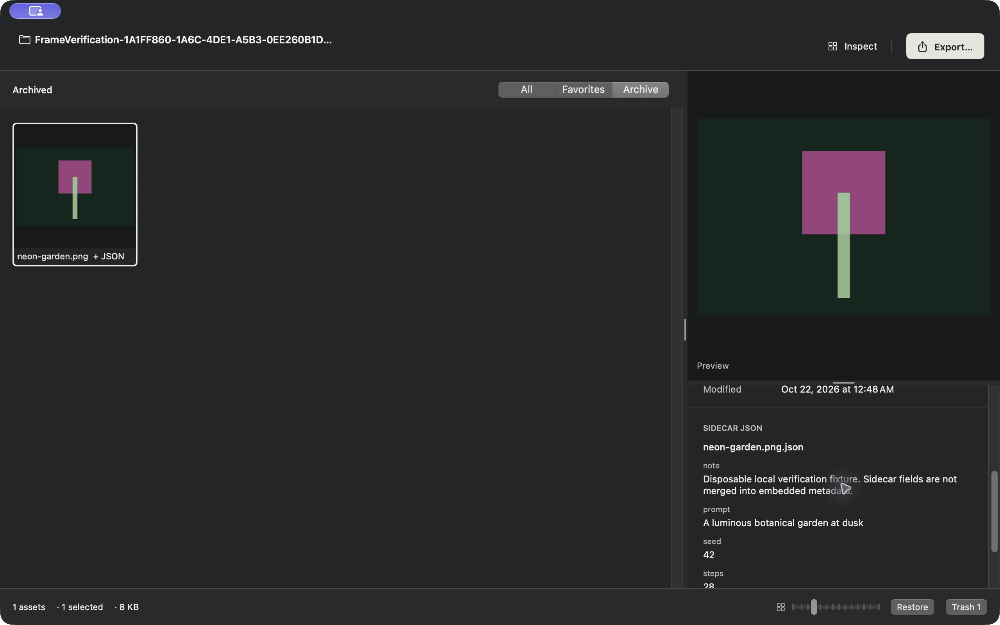
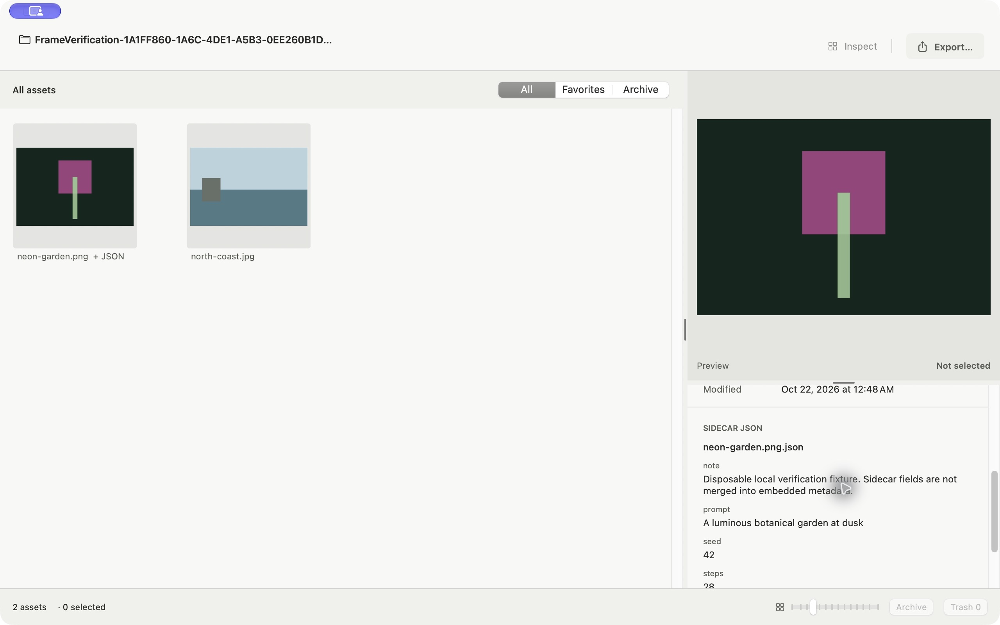
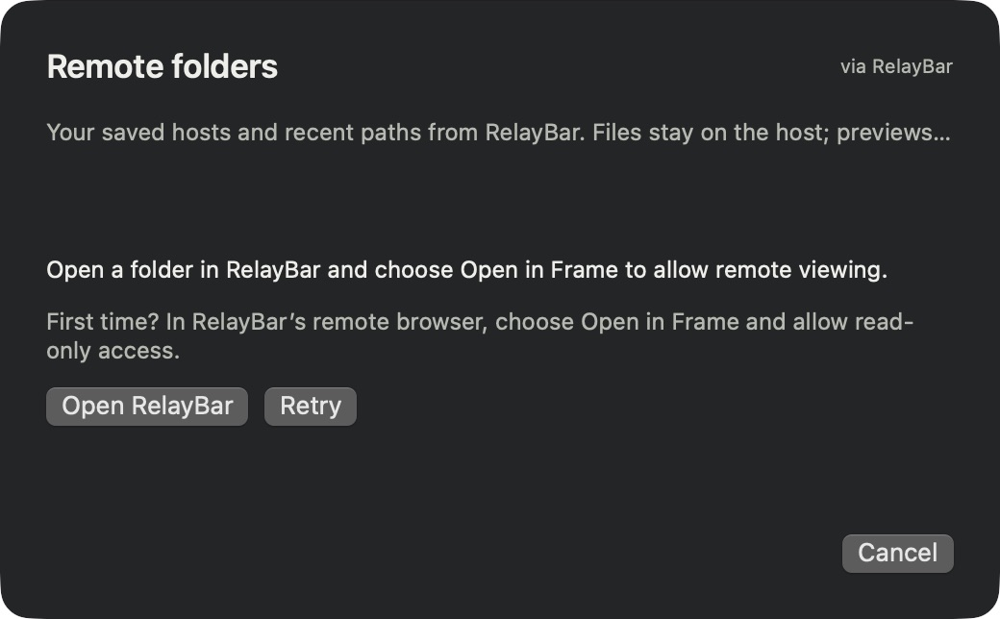

# Verification — assets and RelayBar remote viewing

Date: 2026-10-22

## Installed builds

| App | Version | Build | Architecture | Executable SHA-256 |
| --- | --- | --- | --- | --- |
| `/Applications/Frame.app` | 0.3.0 | 4 | arm64 | `54876baea107ffb09c9b74d38561257d1725caca2d83881cf9dbd62eca3cce26` |
| `/Applications/RelayBar.app` | 1.7.0 | 12 | arm64 + x86_64 | `7f3cc44937cc8a9c126e73b319bd608c1baeb2b3eb57b28d75a5e29db1b19919` |

Both passed strict signatures and explicit Apple-anchored bundle/team requirements for team `39HYFR5Z65`; installed executables match build outputs byte-for-byte. RelayBar nested Sparkle signatures passed, and both architecture dSYM UUIDs matched. Frame's sandbox/bookmark/user-selected entitlements remain; network-client and shared App Group were added. RelayBar has the matching group, without adding App Sandbox. Property lists passed lint. No notarization, publication, commit, push, feed or website update was performed. Frame icon SHA-256 remains `7dea6a405517146a4432e91c7e9ff4db755074d9e13cdf5eb299f15f33c9e04b`.

The user explicitly approved updating both apps and a brief tunnel interruption. RelayBar accepted normal macOS termination; no force-quit was used. Both updated executables were observed running from Applications. Frame launched with its prior catalog/favorite state and no inferred batch selection. Frame's Open RelayBar action launched the updated companion; Retry authenticated it and reached the consent-required response.

## Automated evidence

- Frame: **52 tests, zero failures**, with warnings as errors. Includes 11 paired/archive/export tests and 7 remote protocol/cache tests. Latest 5,000-file scan: 0.291 s; filter: 0.0056 s. Log: `.build/frame-remote-tests.log`.
- RelayBar full suite: **331 tests, 21 opt-in skips, zero failures**. A subsequently added isolated loopback test then passed with all four bridge tests. Log: companion `.build/frame-bridge-tests.log`. Existing skipped live-host and snapshot suites were not relabeled as passed.
- Real `/usr/bin/sftp` listing and exact image/JSON download passed against a disposable `127.0.0.1:31298` sshd with generated keys, strict known-host checking, no passwords/shell/forwarding, and no user SSH config/agent. Fixture wrapper isolates test configuration without changing RelayBar's argument policy. The disposable server was stopped after verification.
- Separate signed UNIX-socket fixture: sandboxed correct Frame identity received `RESULT verified`; differently identified signed client was rejected. Initial proof failures exposed sandbox-inaccessible on-disk code inspection and inherited nonblocking accepted sockets; corrected by kernel-backed dynamic-code validation and blocking accepted descriptors. Installed peer handshake also passed.
- Both copies of `FrameBridgeWire.swift` are byte-identical. RelayBar `git diff --check` passed on `codex/frame-viewer-handoff`.

## Native visual and interaction evidence

Used a separate app ID/catalog and disposable bundled images, not the user's media, for local mutations. One paired PNG/JSON tile archived successfully, disappeared from All, appeared once in Archive with metadata, restored, and returned to All. Screenshots show the native UI in both appearances; final release additionally corrects singular asset wording and adds remote video progress.

Native folder-panel automation was unreliable; the verification-only debug menu copied bundled fixtures into its own sandbox instead. No dialog was confirmed against Downloads. The installed app's normal prior-root restoration was observed without mutating files there. Native automation could not attach reliably to RelayBar's menu-bar-only UI; normal lifecycle termination was used for installation and Frame's own Open RelayBar action for relaunch.

## Remaining acceptance and limits

No user-selected remote host/folder was provided for live acceptance. Therefore first-use Allow, the complete one-click URL focus handoff, a real-host shared-history round trip, jump-host/offline/auth UI, and remote video playback/export are not claimed manually verified. Transport, signature boundary, shared catalog logic, exact transfer, read-only gates, and cancellation have isolated coverage. Real disk-full/permission failures, crash recovery under external concurrent writers, Intel runtime and macOS 14 runtime remain untested; multi-file operations are best-effort recoverable, not atomic transactions.

## Recovery

Exact previous apps are retained under this repository:

- `.build/backups/Frame-0.2.1-build3-2026-10-22.app` — executable SHA-256 `f30ec8583783f40ec2e34367bb789fd5dc4666b633f5e40a61ea659169ffb8e9`.
- `.build/backups/RelayBar-1.6.0-build11-2026-10-22.app` — executable SHA-256 `c14dae34748a904918f5d83f2a1590769eadf76df825a79a7187f40c85634937`.

Preferences, Application Support, local catalog and SSH settings were not removed or migrated by the installer. For rollback, quit the affected app normally, retain the new bundle, and restore the matching backup to Applications. First-use remote permission has not been granted on the user's behalf.
