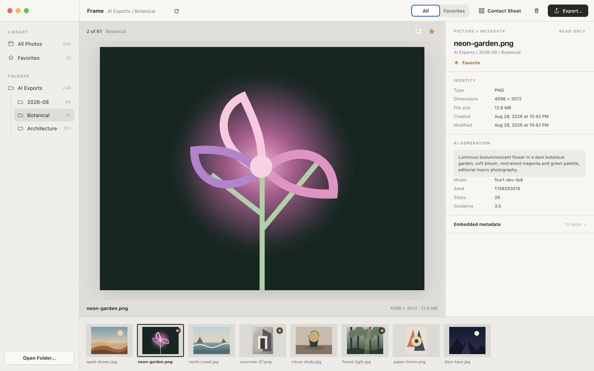
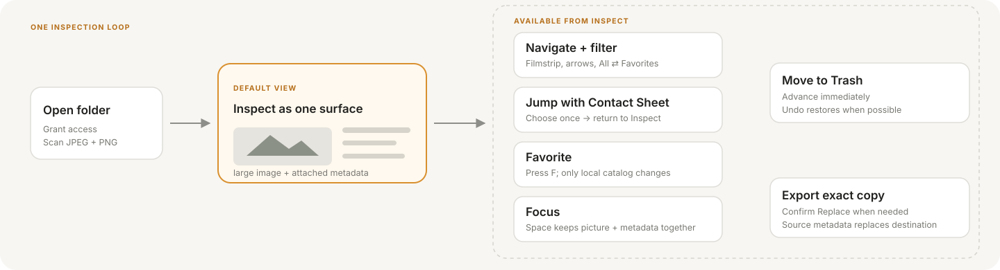
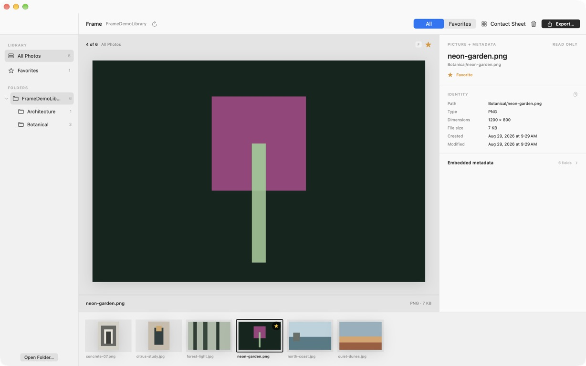

# 2026-08-29: Minimal local photo viewer

Task status: Completed\
Design status: Accepted and delivered\
Created: 2026-08-29\
Revised: 2026-08-29

## Objective

Build a fast, native macOS image browser that opens an existing folder in place and keeps the selected picture and its metadata together. The user can favorite, filter, move an original to Trash, or export an exact copy without gaining a full photo-management or editing system.

## Product definition

Working title: **Frame**.

> Open a folder, see the picture and its metadata together, then favorite, trash, or export it.

Frame does not import photos into a library. Finder remains the source of truth; Frame contributes a private index and favorite flag, plus two explicit file actions: Move to Trash and Export.

## Non-negotiable v1 constraints

- Native macOS app; macOS 14 or newer.
- JPEG and PNG only, matched case-insensitively.
- Fully local execution and storage; no account, sync, analytics, or network calls.
- The default workspace gives the selected image and its metadata equal product priority. There is no duplicated miniature preview in the inspector.
- One organization signal: `Favorite` is either on or off.
- Two filters: `All` and `Favorites`.
- Folder traversal is recursive and preserves the on-disk hierarchy in the sidebar.
- Delete always means **Move to Trash**, never permanent deletion.
- Export handles one selected image, preserves its format and bytes, and replaces the entire destination file when the user confirms replacement.

## Visual prototype

The revised screen is an inspection workspace, not a grid with a detached inspector. A large aspect-fit image and its metadata share one continuous surface. The filmstrip is the normal navigation control; a temporary contact sheet exists only to jump across many images.

[Open the interactive local mock](assets/2026-08-29-minimal-local-photo-viewer/frame-mock.html).

### Layout contract

- Default window: `1440 × 900`; minimum window: `960 × 640`.
- Title/toolbar: 52 pt high.
- Folder sidebar: 192 pt wide and collapsible.
- Unified inspection surface: remaining width, with a fluid image stage and an attached 360 pt metadata column.
- Filmstrip: 132 pt high across the bottom of the inspection surface. It belongs to the current folder/filter result, not to the folder sidebar.
- The image is aspect-fitted and downsampled to the stage; it is never cropped in inspection mode.
- The metadata column has no second preview. Its top edge aligns with the image stage and its filename is the selected image's title.
- Visual language: warm white canvas, cool gray surfaces, nearly black text, and one amber favorite accent. System SF typography keeps the app quiet.
- Favorite, Move to Trash, Contact Sheet, and Export are visible once each; there are no duplicate toolbars.

### View states

1. **Inspect — default:** large image + attached metadata + filmstrip.
2. **Contact Sheet — temporary:** `G` or the grid button replaces the inspection surface with a thumbnail grid. Selecting an image immediately returns to Inspect at that image.
3. **Focus — temporary:** `Space` hides the folder sidebar and filmstrip, but keeps the image and metadata together. `Esc` restores Inspect.

## User flow

1. On first launch, the user chooses **Open Folder**.
2. Frame requests access, remembers a security-scoped bookmark, and scans JPEG/PNG files in the background.
3. The first image opens immediately in Inspect while the filmstrip continues filling.
4. Clicking the filmstrip or pressing the arrow keys changes both the large image and metadata as one selection.
5. `F` toggles the local favorite flag; **Favorites** filters the current folder subtree.
6. `G` opens the Contact Sheet for a fast jump; selecting an image returns to the unified Inspect view.
7. `⌘⌫` moves the selected original to macOS Trash and advances to the next image. A non-modal **Undo** banner can restore it.
8. `⇧⌘E` opens a Save panel for the selected image. Confirming Replace atomically replaces the entire destination file and all metadata it previously contained.
9. `⌘R` reconciles Finder changes with the current view.

## Interaction contract

| Intent | Control | Behavior |
| --- | --- | --- |
| Open a root | `Open Folder…` / `⌘O` | Grants access to one folder. Opening another root changes the active view but retains saved favorite state for prior roots. |
| Browse folders | Sidebar tree | Shows the chosen folder and descendants. `All Photos` selects the entire root. |
| Select | Filmstrip click / `←` `→` | Changes the large image, filename, and metadata together. |
| Jump | Contact Sheet button / `G` | Opens a temporary grid; one click selects and returns to Inspect. |
| Favorite | Star / `F` | Toggles one app-local boolean and persists it. |
| Filter | `All` or `Favorites` | Applies within the selected folder scope and updates the filmstrip/contact sheet. |
| Focus | `Space` | Hides navigation chrome while keeping image and metadata attached. `Esc` returns. |
| Delete | Trash / `⌘⌫` | Moves the original to macOS Trash with no confirmation modal, advances selection, and offers Undo. No permanent-delete path exists. |
| Export | `Export…` / `⇧⌘E` | Exports the selected file in the same format. No resize, re-encode, metadata editor, or batch UI. |
| Refresh | `⌘R` | Rescans the active root and reconciles added, changed, moved, or removed files. |

## Export replacement policy

Confirmed product rule (2026-08-29): “export should override all existing metadata” is a destination rule.

1. The selected source is exported as an exact binary copy, so all of its pixels and metadata are preserved.
2. The Save panel defaults to the source filename and format.
3. If the destination does not exist, Frame creates it.
4. If the destination exists, macOS asks the user to confirm **Replace**.
5. After confirmation, Frame writes a temporary sibling and atomically replaces the whole destination file. None of the destination's former EXIF, XMP, PNG text, comments, or AI-generation metadata survives, because metadata is never merged.
6. The source file is never modified, and exporting onto the source URL is rejected.

This is intentionally not a metadata-scrubbing export.

## Metadata surface

The metadata column optimizes for scanning. Empty rows are omitted, long values are selectable, and each section has one copy action.

1. **Identity** — relative path, format, dimensions, file size, created date, modified date.
2. **AI generation** — prompt, negative prompt, model/checkpoint, seed, sampler, steps, CFG scale, and source application when recognizable.
3. **Capture** — camera, lens, focal length, exposure, aperture, ISO, and capture date when present.
4. **Embedded** — remaining EXIF, IPTC, XMP, PNG text chunks, or comments behind one collapsed disclosure.

AI metadata extraction is best-effort. V1 recognizes common PNG text keys and Automatic1111/Stable Diffusion parameter blocks. ComfyUI `prompt` and `workflow` JSON remain readable raw data when they cannot be summarized safely. Unrecognized embedded text is never hidden from the collapsed section.

## Local data and file safety

Normal browsing and favoriting do not write into the source folder. Frame writes its catalog and thumbnails only under its macOS container:

- `Application Support`: folder bookmarks plus a SwiftData catalog containing root ID, relative path, size, modified time, last observed file identifier, and favorite boolean.
- `Caches`: generated thumbnails, safe to delete and rebuild.

Two user-initiated exceptions are explicit:

- **Move to Trash** asks macOS to relocate the selected original to Trash. Undo restores it only when its former path is still available.
- **Export** writes to the URL the user chooses in the Save panel and follows the replacement policy above.

The catalog key is `root bookmark ID + relative path`. A Finder rename is treated as a removed item plus a new item in v1, so its favorite may need to be set again.

## Technical design

- **UI:** SwiftUI split view with one attached image/metadata workspace, horizontal lazy filmstrip, temporary lazy contact sheet, and native commands.
- **Folder access:** `NSOpenPanel`, security-scoped bookmarks, and recursive `FileManager` enumeration on a background actor.
- **Image display:** ImageIO downsampling at the actual stage scale; a bounded `NSCache` holds decoded stage images and thumbnails.
- **Metadata:** `CGImageSourceCopyPropertiesAtIndex` plus a small reader for PNG `tEXt`, `zTXt`, and `iTXt` chunks. Parsing is lazy and cancellable.
- **State:** SwiftData for roots and favorite state. The source folder receives no sidecars.
- **Trash:** `FileManager.trashItem(at:resultingItemURL:)`; register a bounded native undo action while restoration is possible.
- **Export:** byte-preserving copy to a temporary sibling followed by `FileManager.replaceItemAt` after the Save panel's replacement confirmation.
- **Change model:** scan on open and explicit refresh. Live filesystem watching is deferred.
- **Network:** no networking package or network entitlement.

The indexer emits lightweight file records in batches. Work priority is: selected stage image, selected metadata, visible filmstrip/contact-sheet thumbnails, then prefetch.

## Performance budgets

Test on a baseline Apple-silicon Mac with 5,000 mixed JPEG/PNG files:

- Show the shell and folder tree within 250 ms after the root bookmark resolves.
- Show the first selected stage image and 12 filmstrip thumbnails within 1.5 seconds on a cold cache.
- Change to a cached adjacent image within 100 ms.
- Maintain at least 55 fps while scrolling the filmstrip or Contact Sheet.
- Apply the favorite filter within 100 ms after the catalog is loaded.
- Keep decoded image memory below 384 MB through cache eviction.
- Never decode more pixels than the current stage or thumbnail requires.

## Acceptance

- [x] A folder opens in place and the first selected JPEG/PNG appears with its metadata in one unified workspace.
- [x] Filmstrip selection and arrow navigation update the image and metadata together without a duplicated preview.
- [x] Contact Sheet selection returns directly to Inspect at the chosen image.
- [x] Favorite state persists across relaunch and filters correctly inside the selected folder scope.
- [x] Camera JPEG metadata and AI-generated PNG metadata follow the ordered metadata surface; missing fields create no blank rows.
- [x] `⌘⌫` moves the selected original to Trash, advances selection, and exposes a working Undo when restoration is possible.
- [x] Export creates an exact binary copy; replacing an existing destination leaves it byte-identical to the selected source and retains none of its former metadata.
- [x] `F`, `G`, `Space`, arrows, `⌘O`, `⌘R`, `⇧⌘E`, `⌘⌫`, and `Esc` behave as specified.
- [x] No code path permanently deletes a file, edits an original, writes a sidecar, re-encodes an export, or sends a network request.
- [x] The performance budgets are recorded against the baseline library.

## Explicit exclusions

RAW, HEIC, TIFF, GIF, video, cloud libraries, Photos.app integration, albums, tags, star ratings, color labels, search, duplicate detection, face recognition, map view, image editing, multi-selection, batch delete, batch export, resizing, format conversion, metadata editing, metadata scrubbing, sharing, printing, live folder watching, and automatic AI model/provider calls.

## Product decisions

- Inspect is the default. The full image and metadata remain attached in Inspect and Focus; the Contact Sheet is only a temporary jump surface.
- Delete means immediate Move to Trash with a bounded Undo opportunity and no permanent-delete path.
- Export is byte-identical to the source and completely replaces destination metadata rather than stripping source metadata.

## Completion record

Completed on 2026-08-29 as a native SwiftUI macOS application.

### Outcome

- Delivered `Frame.app`, a locally signed sandboxed application bundle for macOS 14 or newer.
- Delivered a custom macOS icon whose single symbol keeps the photograph, attached metadata rail, and favorite state together. The generated 1024 px alpha master is converted into a complete `.icns` resource during asset preparation and embedded in the signed bundle.
- Implemented recursive in-place JPEG/PNG browsing, the unified image/metadata workspace, filmstrip navigation, Contact Sheet, Focus, favorites, folder-scoped filters, refresh, Move to Trash with Undo, and exact-copy export.
- Stored only security-scoped root bookmarks and favorite records in SwiftData. Source folders receive no imports, catalog files, or sidecars.
- Added lazy ImageIO downsampling with a 384 MB decoded-image cache and best-effort EXIF, PNG text, Automatic1111, Stable Diffusion, and ComfyUI metadata reading.

### Verification

- `swift test`: 7 tests passed with 0 failures.
- 5,000-file synthetic library: scan `0.229 s`; favorite filter `0.0037 s`.
- One stage image plus 12 thumbnails, cold synthetic load: `0.0015 s`; cached adjacent load: `0.000005 s`.
- Native UI walkthrough: folder open, recursive counts, filmstrip/arrows, favorite persistence after relaunch, Contact Sheet, Focus/Escape, and export Save panel verified.
- Exact replacement test: existing destination bytes became byte-identical to the source while the source remained unchanged.
- Release bundle: `codesign --verify --deep --strict` and both property-list lint checks passed.
- Icon resource: `CFBundleIconFile` resolves to the embedded `AppIcon.icns`; the project and bundled resources are byte-identical, and the 1024 px master has a genuine alpha channel.
- Source audit found no networking API or network entitlement. The only write paths outside Frame's private catalog are the explicit Trash and Export commands.

The Trash command itself was not invoked during automated UI control because that would move a local file without a separate destructive-action confirmation. Its implementation was code-audited: it uses `FileManager.trashItem`, advances selection, records the returned Trash URL, and restores with `moveItem` only when the original path is free.

### Delivered screenshot

### Delivered app icon

The icon was produced with the built-in `imagegen` workflow, then refined to remove tiny camera-style glyphs and to provide clean transparent corners for the macOS icon resource.
