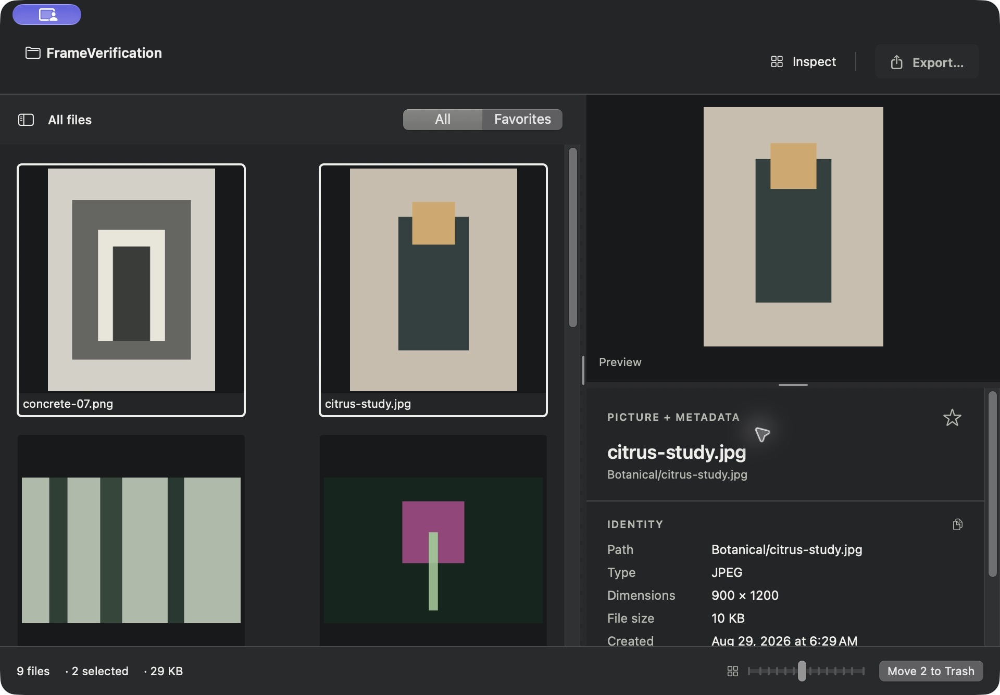

# Adjustable Contact Sheet

Status: Completed in 0.2.1
Created: 2026-10-21

## Objective

Judge images without opening them individually: resize thumbnails and the attached preview while keeping metadata visible.

## Scope and decisions

- One footer slider, 100–360 pt thumbnails, 160 pt default; saved across launches.
- Native draggable divider between grid and preview; a second divider between preview and metadata. Pane sizes persist.
- Larger panes request higher-resolution bounded images, not stretched small thumbnails. Grid requests debounce and retain existing images while upgrading.
- Grid reflows without resetting selected assets; keyboard rows follow the current column count. Preserve the visible anchor when changing thumbnail size.
- Keep aspect-fit images, lazy decoding, the existing 128 MB cache, and static video posters in Browse.

## Acceptance

- [x] Slider visibly changes cells, and larger previews resolve more detail.
- [x] Both dividers resize and remember their positions.
- [x] Selection and Inspect round trips survive resizing; minimum-window layout remains usable.
- [x] Tests cover sizing bounds, keyboard geometry, persistence, and actual larger decoding.
- [x] Rebuild and update Applications with a recoverable previous app.

## Exclusions

Remote folders, archive, and JSON asset pairing are separate additions; their transport and archive semantics need to be finalized before implementation.

## Completion record

Delivered Frame 0.2.1 build 3 to Applications, with the prior 0.2.0 app preserved. Native handles control pane dimensions; a single footer slider controls cells. Size-aware decoding remains bounded and selection is independent of layout. All 34 tests passed; native checks and explicit limits are in the [verification record](../system-specs/verification-2026-10-21-resizing.md).

