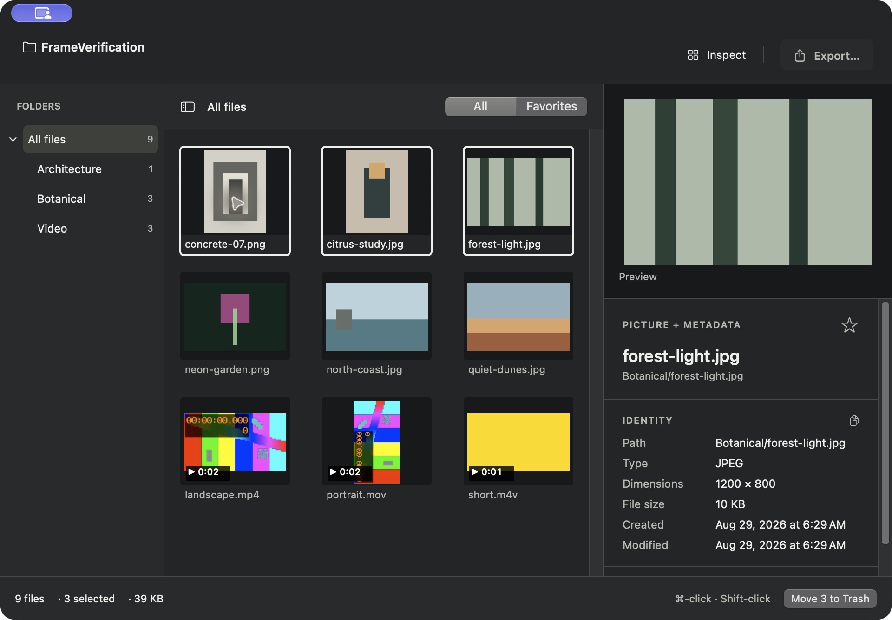

# 2026-10-21: Contact Sheet selection and batch Trash

Task status: Completed — 2026-10-21\
Design status: Accepted — requested by the user during implementation; two design reviews plus a code audit

## Outcome

Make Contact Sheet the folder’s selection screen: a reusable thumbnail grid, a collapsible folder outline, and a nearby preview with metadata. The long subfolder dropdown from the earlier proposal is superseded.

## Design and interaction

    Folder / location                                  Inspect   Export one…
    ┌ Folders ───────┬ All files           All | Favorites ┬ Preview ──────┐
    │ All files     │ [thumb] [thumb] [thumb]             │ aspect fit   │
    │   Botanical   │ [thumb] [thumb] [thumb]             │ name + star  │
    │   Video       │ reusable, scrolling collection     │ metadata     │
    └───────────────┴────────────────────────────────────┴──────────────┘
    120 files · 4 selected · 18 MB                     Move 4 to Trash

- Open a root in Contact Sheet. The optional 176 pt folder outline is only in Browse; Inspect retains the large media stage and attached 310 pt metadata column.
- One All/Favorites filter applies recursively within the chosen folder. Switching root/scope/filter clears the previous batch targets.
- Opening or changing scope previews the first file without selecting it for batch actions. Child folder branches start collapsed; only the root starts expanded.
- Plain click replaces selection and previews. Command-click toggles one file. Shift-click selects an anchored contiguous range; Command-Shift-click adds that range. Option-click keeps ordinary selection behavior; no destructive Option shortcut.
- Command-A selects the whole current scope, including offscreen files. Command-Shift-A clears selection. Arrow keys move current selection; Shift-arrows extend; Command-arrows preview without changing targets. Home/End/Page keys navigate the grid.
- Preview and batch selection are separate. A deselected preview has a “Not selected” marker. Zero selections disable Inspect, Export and Trash.
- Return/double-click enters Inspect, preserving the set and scroll position. Inspect arrows step through a multi-selection, otherwise the scope. Escape leaves Focus first, then returns to Contact Sheet.
- Browse video previews are static posters. Playback is in Inspect only, paused initially. Space only controls an actual player.
- Inspect Trash is explicitly singular. Contact Sheet Trash uses the visible selected count. Export remains single-file, byte-exact, with complete destination metadata replacement.

## Batch safety

Command-Delete moves the snapshot of selected sources to macOS Trash off the main thread. Bare Delete is not destructive. The operation locks selection/root/scope/filter changes, reports progress, and offers Cancel. Cancellation stops future moves; successes remain one undoable group.

Before each move, fetch fresh file identity, modification date and size, clearing Foundation URL resource caches. Detected changes or replacements are reported and skipped. These checks are not an atomic transaction against concurrent external filesystem writers. Partial failures remain selected and appear in one summary with filenames/reasons. Undo restores only successes, never overwrites occupied paths, retains retryable failures, and removes missing/replaced Trash entries from retry history. The bounded session history holds 20 groups; the seven-second notice is not the lifetime of Undo.

## Performance boundary

NSCollectionView recycles cells and changes visible selection highlights without reloading the data. Thumbnail work is downsampled, cached under a 128 MB cost limit, and limited to four concurrent decodes. Offscreen/cancelled requests skip decoding when dequeued. Browse preview is sized to the pane and debounced 50 ms. Video metadata is also bounded. No full-resolution grid decode or playback on hover.

## Design consultation

All three additional reviews ran in one session and completed successfully. The first two shared only requirements and text layouts. For the third, the user explicitly approved sharing UI/store source and the design document. No media or catalog data was shared.

Round 1: adopted independent preview/selection, conventional modifiers, persistent count, grouped Undo, and bounded reusable thumbnails. Rejected new caption modes, grouping, folder tiles, redo, and filesystem watching as beyond this minimal update.

Round 2: adopted “Not selected,” empty-selection command validation, navigation locks during file operations, identity checks, explicit cancellation accounting, and partial restore reporting. Scrolling remains available during operations; preview-changing clicks are temporarily locked with selection to keep the operation state unambiguous.

Round 3, code audit: fixed all five reported defects. Range anchors reset when ordered files change and clamp to the valid range; root/scope/filter changes no longer arm Trash; singular Inspect Trash preserves surviving batch targets; missing or replaced Trash entries are reported and removed from retry history; Inspect navigation is locked during file operations. Added regression tests for these paths and removed the unreachable old grid.

## Native design

[Light appearance](../system-specs/assets/2026-10-21/contact-light.jpg) · [Image inspection](../system-specs/assets/2026-10-21/image-light.jpg) · [Video inspection](../system-specs/assets/2026-10-21/video-dark.jpg)

## Acceptance

- [x] Native plain/Command/Shift selection, Select All/clear, and keyboard ownership.
- [x] Preview stays adjacent to metadata; multi-selection survives Inspect round trip.
- [x] Batch cancellation, partial failures, stale sources, grouped Undo, and restore collisions tested.
- [x] Reusable cells and large selection avoid eager media decoding.
- [x] Both appearances and the 960 × 640 minimum verified.
- [x] Rebuilt release installed in Applications with the previous app recoverable.

## Exclusions

No batch export, destructive permanent delete, tags, ratings, search, editing, codec downloads, watcher, or network access.

## Completion record

Delivered in Frame 0.2.0 (build 2). The native reusable grid is now the default selection screen, with a collapsible folder outline, attached preview/metadata, familiar modifiers, counted batch Trash, and grouped session Undo. Single-file Inspect actions preserve surviving batch targets. Accessibility press activates a thumbnail, and range anchors are tested independently of decoding.

Verification: all 30 tests passed; native repeated Shift-arrow, Shift-click, Command-toggle, Select All/clear, empty actions, layered Escape, and Inspect round trip were checked. The installed release passed range-selection smoke verification and strict signature checks. [Complete evidence, screenshots, limitations, and backup](../system-specs/verification-2026-10-21.md).

Deviations: Option-click is ordinary selection, matching the standard Command/Shift batch model instead of introducing an unfamiliar Option action. Batch export and permanent deletion remain excluded. Complete accessibility traversal and physical removable-volume recovery are manual follow-ups, not claimed as verified.
