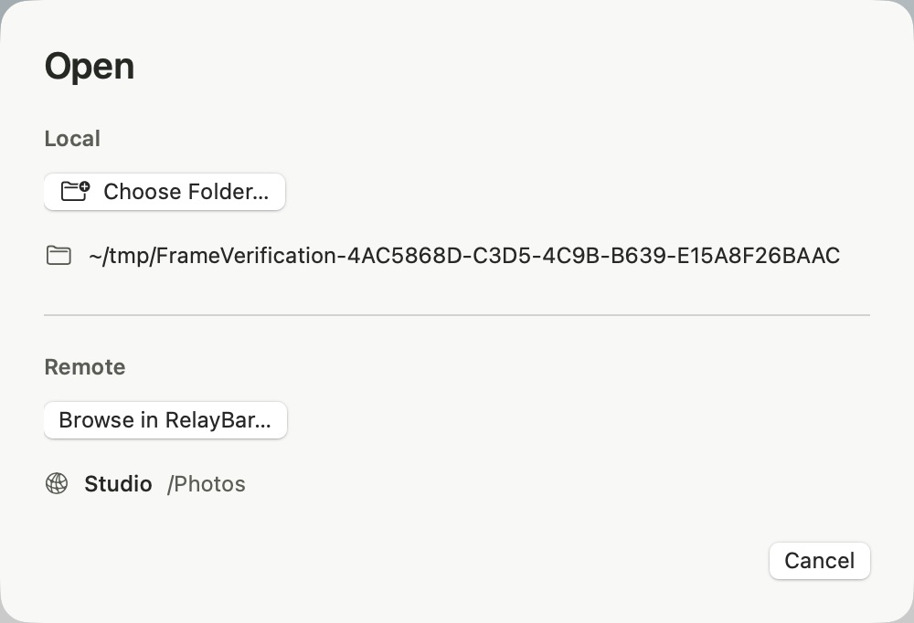
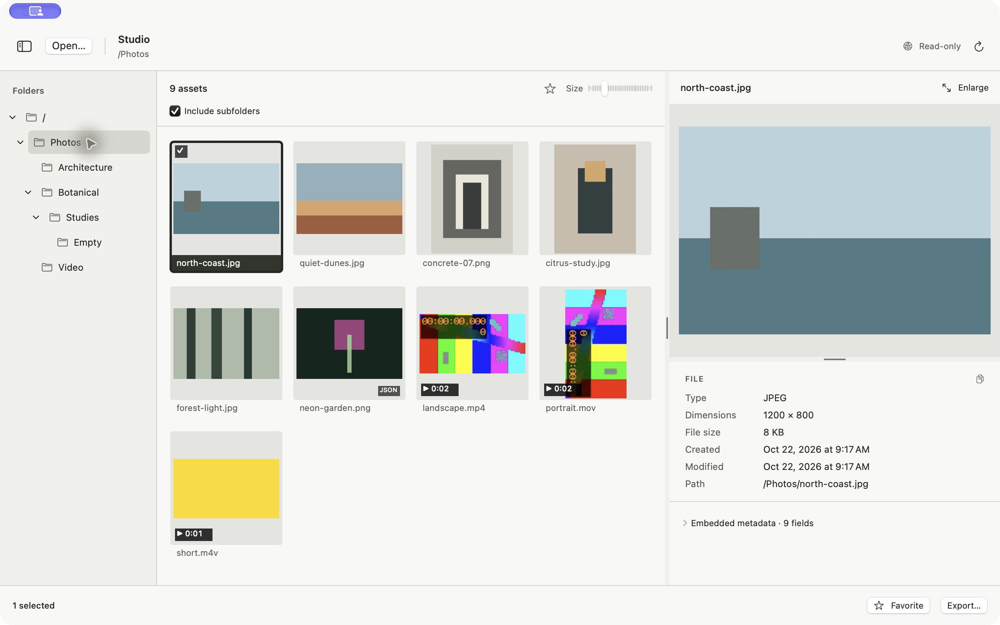

# Remote folder tree and quieter navigation

Status: Completed · installed in 0.5.0 (build 6)
Created: 2026-10-22

## Request

Give remote folders the same expandable hierarchy as local folders, load children on demand, and provide Include subfolders. Merge Open folder and Open from RelayBar into one Open… button with local choices above remote. Add Settings to hide remote. Preserve subfolder structure. Remove redundant UI copy and ask for a design review. Rebuild and update Frame in Applications.

## Accepted design

- Open… / Command-O presents a compact sheet over the existing workspace. Local folder picker and five recent paths first; remote recent host/path pairs and Browse in RelayBar… below. One first-use sentence only when there are no remote recents. Cancel preserves the current view.
- The folder rail contains the hierarchy, not a second recent-history list. The chosen root stays anchored while navigating descendants; moving up extends it. Native disclosure buttons, folder icons, selection and indentation apply to both local and remote trees. Empty local folders are retained. The rail stays visible by default at minimum window size; users can hide it.
- Expanding a remote row lists only that directory. Selecting it shows direct assets by default. Include subfolders opts into a progressive, cancellable breadth-first scan. The image and metadata preview stays resizable.
- A count, Include subfolders, progress/Stop while running, and Partial only when incomplete replace recurring scope subtitles. Error details and Retry are contextual, not onboarding copy. Metadata values and action scope labels remain because they affect review and destructive actions.
- Frame → Settings… → Show remote folders persists. Off hides remote choices, suppresses catalog/handoff requests, cancels the active remote session and returns to the empty local workspace. It does not revoke RelayBar consent, delete shared history, or stop SSH connections.

## Performance and safety

- One directory request and two prioritized media transfers at a time in Frame. Folder expansion never downloads media. Visible images retain existing lazy bounded decoding and transfer caches.
- Recursive scan bounds: 512 folders, 20,000 assets, depth 64. Tree has at most 20,000 known nodes. Bounded 60-second listing cache: 64 directories / 20,000 assets. Progress publishes no more often than 150 ms after the initial batch. Stop/navigation/hide cancels work and rejects late results.
- Directory errors retain partial results; scanning stops after three failed folders. Bounds and Stop are explicitly marked Partial, never presented as complete.
- RelayBar v1 retains only 32 listings. Frame renews expired capabilities when a visible thumbnail needs them, checks the original media/JSON entry identity (path/name/size/modification text), and refuses changed files. No remote mutation API or SSH code is added.
- Network latency dominates real remote traversal. RelayBar v1 also records each successful directory list in shared recent history, including expansion/scanning; changing that requires a future coordinated protocol update. No RelayBar modification is in this task.

## Design review

Two design reviews were completed:

1. [Supplied screenshot and proposal](../design/assets/2026-10-22-remote-folder-tree/design-review-1.md): replace onboarding with a picker; remove slogans, duplicated read-only explanations and numbered steps; use Show remote folders and concise Local/Remote sections. Adopted. Kept explicit Partial instead of a mixed checkbox because inclusion remains enabled even when traversal stops. Did not add deletion of RelayBar-owned history or disable launching a stopped RelayBar.
2. [Native synthetic screenshots](../design/assets/2026-10-22-remote-folder-tree/design-review-2.md): identified inconsistent sidebar counts and an unnecessarily single-column compact grid. Removed sidebar counts rather than adding more counting semantics, and allow at most 12.5% thumbnail shrink to fit an additional column. Changed Partial's retry to Scan Again, aligned Open-section actions above their lists, removed single-item Favorite's redundant numeral, and removed the repeated host in the path. Verified those refinements natively. Parent traversal remains allowed within the host's existing access; the bridge has no separate share-root boundary to invent.

## Acceptance

- [x] On-demand cached remote expansion preserves ancestor/sibling structure.
- [x] Opt-in recursive media scope with bounds, cancellation, partial/error state and no bulk media prefetch.
- [x] Empty local folder structure and direct/recursive local scope.
- [x] One Open… entry point and persisted remote visibility setting.
- [x] Expired-listing recovery rejects changed same-sized remote files.
- [x] Design review of copy/navigation.
- [x] Native verification of hierarchy, chooser, settings, light/dark and resizing.
- [x] Final tests, signed build and recoverable Applications update.

## Exclusions

No Finder mount, remote writes, RelayBar update, public release, new consent grant, or connection to an unchosen private host. Live remote latency/authentication testing is separate from synthetic transport verification.

## Completion record

Delivered and relaunched `/Applications/Frame.app` 0.5.0 (build 6). 69 tests passed. Strict Developer ID signature and installed executable hash verified; prior 0.4.0 bundle retained intact in project backups. Both design review rounds completed. Documentation preserves accepted intent here and observable behavior in the current system spec. [Verification, screenshots, measurements, rollback and limitations](../system-specs/verification-2026-10-22-remote-folder-tree.md).
