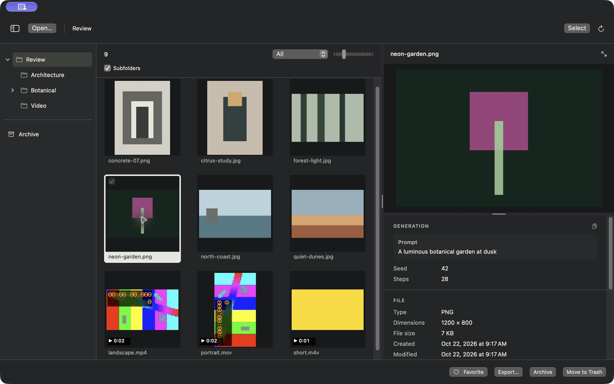
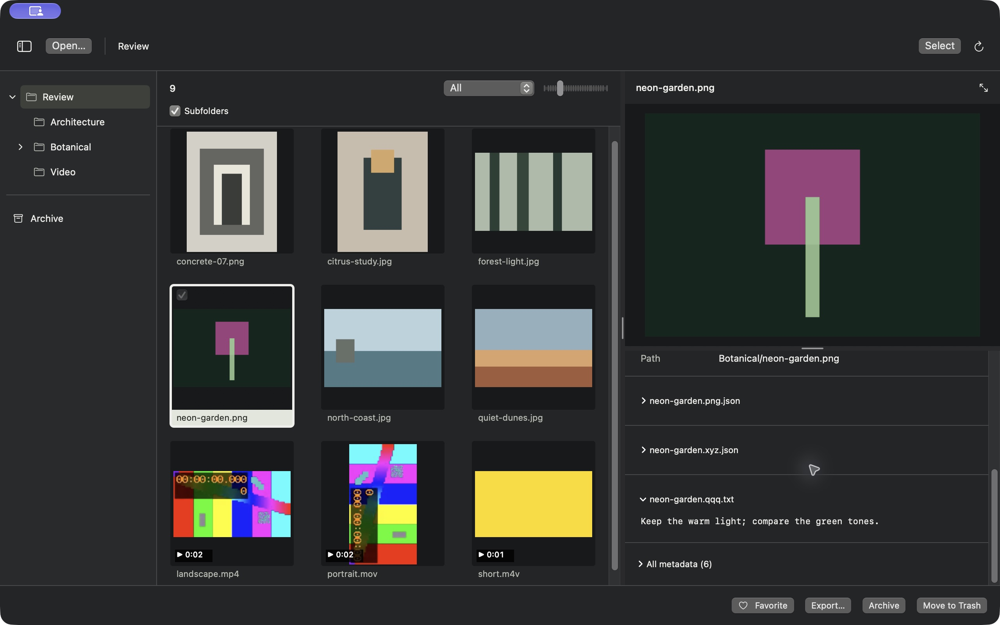

# Smooth review and batch actions

Status: Completed; installed 2026-10-23
Created: 2026-10-22

## Outcome

Review, mark and delete assets without losing position, reloading the contact sheet, or requiring video tools on the remote host.

## Work

- Remove the obsolete Read-only label and redundant status copy.
- Add All / Favorites / Hide favorites filtering; keep Archive separate.
- Update the virtualized grid by stable asset IDs. Keep surviving thumbnails and scroll position after deletion.
- Delete a selection with a batch request and one host invocation per batch, including all companion files; return per-asset failures. No confirmation or remote Trash.
- Keep the current preview if it survives; otherwise show the next surviving asset in the previous visible order, falling back to the previous one.
- Add Select mode: preview/navigation and checked deletion targets are independent. Space toggles the current asset, arrows browse, Delete acts on checked assets.
- F and the heart toggle the current favorite and advance in folder order. Select mode retains checked deletion targets; ordinary multi-selection retains batch Favorite.
- Group arbitrary same-folder companions, not a JSON suffix whitelist: `name1.png`, `name1.prompt.json`, `name1.xyz.json`, and `name1.qqq.txt` form one item. Longest dot-delimited prefix wins; exact media filenames win ties; ambiguous stems stay ungrouped. All companions follow delete, archive, restore and export. Text/JSON previews are bounded.
- Play selected remote videos with native macOS playback, as RelayBar does. Missing host ffmpeg/ffprobe must not block viewing; do not download every video for the contact sheet.
- Store remote previews, metadata and downloaded originals only in session temporary storage. Clear it on exit/startup and remove the previous persistent preview cache.

## Acceptance

- [x] No Read-only badge; the three filters work in the current folder/subfolder scope.
- [x] Deleting 100 selected remote items in one folder uses one batch mutation request and one helper invocation; companion groups and partial failures are tested.
- [x] Single, discontiguous and recursive-scope deletion preserves visible order, active preview and selection targets correctly.
- [x] Native 2,000-image check: delete 100, retain image-1098 and its surrounding viewport, show 1,900 items. Stable-ID diffs replace full reloads; decoded thumbnail caching remains in place. No frame-time guarantee is claimed.
- [x] Select mode retains checked targets in the grid and enlarged/full-screen viewer; Space, Delete, F and the heart were exercised with synthetic files.
- [x] JSON/TXT/arbitrary companions group locally and remotely; tests cover ambiguity, nested names, archive/restore, export, deletion and metadata.
- [x] Remote video playback test makes one original download and zero host-preview calls. Host poster generation remains optional; macOS codec/100 MiB limits remain.
- [x] Cache tests cover reuse within one session, cleanup, and no persistent-cache reuse.
- [x] Relevant tests and builds pass; current specs record changes and unverified live-host behavior.

Release versions stay unchanged. No publication or Applications replacement is included in this task unless requested.

## Execution notes

RelayBar's Git fetch and local bridge changes were approved. Fetch succeeded; the feature branch has zero divergence from its origin/main base. No remote user files are used for destructive tests.

## Result and review

Implemented with bridge v5. At the user's follow-up request, both apps were rebuilt, signed and installed in Applications on 2026-10-23: Frame 0.1.0/11 and RelayBar 1.6.0/17. Only build numbers changed. Launch, bridge catalog connectivity and removal of the old persistent cache were verified. No publication, commit or push.

One [harsh UI review](../design/assets/2026-10-22-ui-cut/design-review-1.md). was completed. The follow-up hit an account session limit. Applied: consistent hearts, one-line location, removed JSON badges/source captions/Size label/duplicate Undo, simpler empty states, no separate Focus mode, no local batch/Archive confirmation. Kept the requested Select mode and explicit Original download. Used “Hide favorites,” not the proposed ambiguous “Others.” The central key monitor already handled Space; the review's missing-shortcut claim was not accepted.

Flow: Open → select a folder → preview beside metadata → F/heart to favorite and advance, or Select → Space/check targets while browsing → Delete. Archive remains separate.

[Verification and remaining limits](../system-specs/verification-2026-10-22-smooth-review.md).
