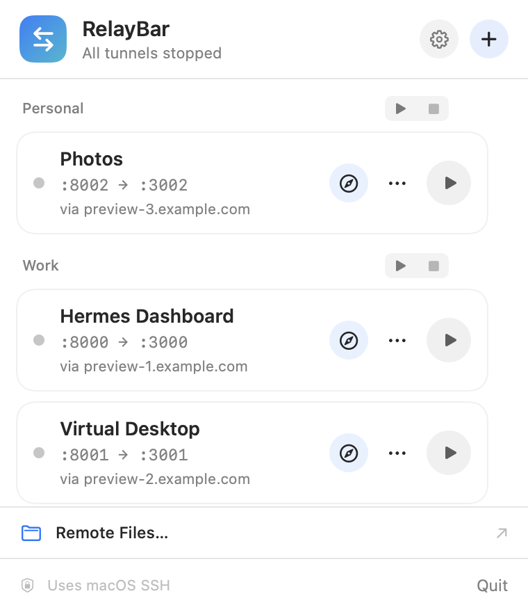
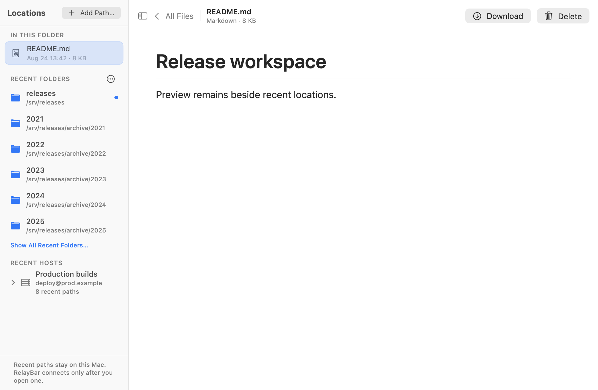

# RelayBar and Frame

RelayBar keeps SSH forwarding profiles in your Mac's menu bar and opens remote files by path. Frame is its companion for reviewing images, video and documents in a folder workspace. Both are native macOS apps; RelayBar runs the system's `/usr/bin/ssh` and `/usr/bin/sftp` directly.

[Download stable RelayBar v1.6.0](https://github.com/lx2026/RelayBar/releases/download/v1.6.0/RelayBar.zip) · [Changelog](CHANGELOG.md) · [Frame source](Apps/Frame)

## Availability

| | Public download | Current source |
| --- | --- | --- |
| RelayBar | **1.6.0, build 11**, notarized; macOS 13+ | New companion, plugin and Markdown work is under test. |
| Frame | No public release yet | macOS 14+; local folders work independently, remote folders use RelayBar. |

The current source uses **bridge v7**. Build and update both apps from the same revision for remote access. Older bridge versions are rejected with an update message. The stable RelayBar download does not include the new Frame integration, Plugins window or shared Markdown renderer.

## Install stable RelayBar

```sh
brew install --cask lx2026/tap/relaybar
```

Update with `brew upgrade --cask lx2026/tap/relaybar`, or use RelayBar's **Check for Updates…**. Automatic checks are optional; downloads and installation require user action.

If RelayBar was installed manually, quit it and remove the existing `/Applications/RelayBar.app` before the first Homebrew installation. Homebrew does not overwrite an app it does not manage. Keep application data to retain your profiles and recent locations.

## RelayBar

- Import repeated or mixed `-L`, `-D` and `-R` rules from forwarding-only SSH commands.
- Combine TCP, Unix sockets, local/reverse SOCKS and automatic remote ports over one connection per profile.
- Group profiles; start, stop, retry and open supported local endpoints from the menu bar.
- Set an SSH retry limit from 0–100. Unexpected disconnects retry with exponential backoff; 0 disables retries.
- Reopen recent remote folders or paste an exact path using a saved host, forwarding profile or concrete SSH-config alias.
- Upload one file through failure-safe staging; download files and folders with progress and cancellation.
- Preview images, Markdown, JSON and MP4. Permanent remote deletion has a five-second Undo window before submission.

For example, Quick Add accepts `ssh -N -D 9999 -p 1234 user@server`. To resolve a SOCKS destination on the SSH-server side:

```sh
curl --socks5-hostname 127.0.0.1:9999 https://example.com
```

RelayBar forwards TCP; it does not provide UDP or DNS service or change macOS proxy settings. Reverse SOCKS makes connections from the Mac's network position. Remote non-loopback listeners also depend on the SSH server's `GatewayPorts` policy.

<p align="center">
  
  
</p>

## Current source: Frame, plugins and documents

These features are implemented in the working tree and undergoing native acceptance. They are not part of the stable download.

**Frame** opens existing folders without importing files. Browse a folder tree or contact sheet, inspect images and video with their metadata, and read Markdown, HTML and text. General files remain visible even without a preview. Favorites, companion-file grouping, Archive/Restore and exact-copy export keep related files together. Local deletion uses macOS Trash with Undo; remote Delete is immediate and permanent, with no confirmation or Undo. Frame never changes RelayBar's recent-folder history.

**Plugins** can be switched in either app's Plugins window, which also shows their dependencies and status. These are built-in features, not downloadable third-party code.

| App | Plugin | Default | What it does |
| --- | --- | --- | --- |
| RelayBar | Reconnect on Wake | On | Brings a waiting retry forward after wake or network return, preserving its retry budget. |
| RelayBar | Service Labels | Off | Checks forwarded loopback HTTP endpoints for a short product or page label, every 30 seconds while enabled. |
| RelayBar | Open in Frame | On if Frame is installed at launch | Shows Open in Frame in Remote Files and runs the local bridge Frame uses; while off, RelayBar shows nothing of Frame. |
| Frame | Prompt Search | On | Filters the current folder by filenames and companion text; Command-F focuses search. |

**Markdown** uses one shared renderer in both apps: highlighted code with Copy, typeset math, callouts, footnotes, frontmatter properties and aligned tables. Each app keeps its own palette and resource policy. Raw Markdown HTML is literal text; Mermaid remains source. Frame skips enrichment above 2 MiB; RelayBar limits Markdown input to 2 MiB.

Measured on the same dense test documents, RelayBar's warm preview time fell from 0.9 s to about 0.04 s at 20 KB and from 7.2 s to about 0.5 s at 200 KB. Frame's 200 KB preview grew from 0.07 s to 0.32–0.51 s with enrichment; 1 MB took about 1.6 s. These are local fixture measurements, not startup or remote-transfer guarantees. [Renders, method and limitations](docs/verification/063-one-markdown-renderer.md).

## Access and document boundaries

RelayBar is intentionally not sandboxed. It uses your normal SSH config, known hosts, identity files and agent; non-interactive connections cannot ask for passwords. Imported command options that execute local commands, select arbitrary config files or write logs are rejected. RelayBar invokes no shell. macOS may ask for Local Network access for LAN hosts.

Frame is sandboxed and uses selected-folder access for local files. Remote operations go through the authenticated local bridge to RelayBar, which retains SSH credentials and authority. Both apps verify the other's signed identity.

RelayBar's Markdown preview runs no document script and fetches no document images or embeds; clicked web/email links go to macOS. Frame's Markdown can load images and follow neighbouring document links. **HTML previews in both apps can run page scripts and load online resources.** HTML has no bridge to file actions, shell commands or clipboard writes. See [document security boundaries](docs/system-specs/shared/security-boundaries.md).

## Build and test

Use full Xcode with Swift 6.2 or newer and the macOS SDK. RelayBar targets macOS 13+; Frame targets macOS 14+. Signed app bundles require a Developer ID Application certificate.

From the repository root:

```sh
./scripts/test.sh                         # shared package and both apps
./scripts/build-app.sh release            # .build/RelayBar.app
./Apps/Frame/Scripts/build-app.sh release  # Apps/Frame/.build/app/Frame.app
```

Both Release app builds contain Apple Silicon and Intel slices. Frame's Debug build uses the host architecture. The scripts retain app entitlements and bundle the renderer's resources and licenses.

For development without a signing identity, run `swift build --package-path Apps/Frame --product Frame` or build RelayBar's Xcode target with `CODE_SIGNING_ALLOWED=NO`. These do not replace the signed app-bundle workflow.

Local packaging accepts an app name:

```sh
./scripts/package-release.sh relaybar
./scripts/package-release.sh frame
```

After explicit distribution approval, `scripts/notarize-release.sh relaybar` or `scripts/notarize-release.sh frame` uses the selected app's archive. Set `NOTARY_PROFILE` to your Keychain profile and `RELAYBAR_PUBLICATION_APPROVED=yes` for that invocation. The script requires an Accepted result, staples, rebuilds the ZIP and verifies a clean extraction. The maintainer's existing profile is `AC_NOTARY`; no credentials belong in the repository. See the [release guide](docs/system-specs/operations/build-and-release.md).

## Source layout

- `Apps/RelayBar`: menu-bar app, SSH/SFTP operations, bridge host and Xcode project.
- `Apps/Frame`: sandboxed folder, media and document viewer.
- `Packages/AppComposition`: composition kernel, plugin UI, bridge protocol, preview contracts, grouping and Markdown rendering.
- `scripts/`: tests, builds and distribution tools. `docs/`: static website, specifications and verification.

The apps retain separate bundle identities and release artifacts. RelayBar's Sparkle feed and Homebrew cask remain its own. Start with the [system specs](docs/system-specs/README.md) and [adding a feature](docs/system-specs/shared/adding-a-feature.md). Dependency versions are pinned; required notices and font licenses ship in the app bundles.
